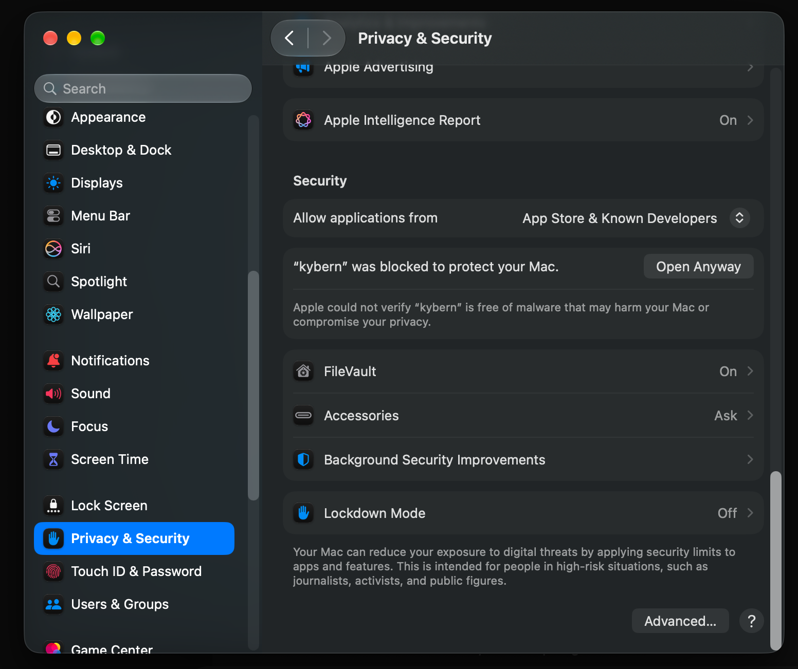
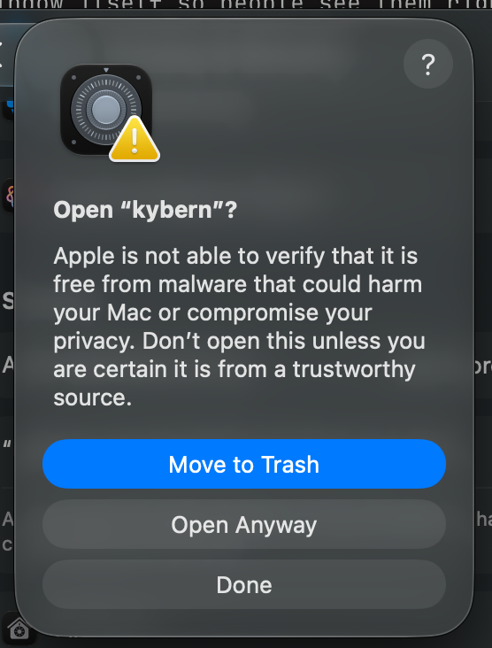

<p align="center">
  <a href="https://github.com/Tresnanda/kybern">
    
  </a>
</p>

<h1 align="center">Kybern</h1>

<p align="center">
  <b>The multi-threaded desktop studio for autonomous coding agents.</b><br>
  Orchestrate Claude Code, Codex, OpenCode, Cursor, and Pi in isolated git worktrees with native protocols, unified diffs, and zero context leakage.
</p>

<p align="center">
  <b>English</b> • <a href="README.id.md">Bahasa Indonesia</a>
</p>

<p align="center">
  <a href="https://github.com/Tresnanda/kybern/actions/workflows/ci.yml"></a>
  <a href="https://github.com/Tresnanda/kybern/releases/latest"></a>
  <a href="LICENSE"></a>
</p>

<p align="center">
  
  
  
  
</p>

<p align="center">
  <a href="#quick-install">Quick Install</a> •
  <a href="#supported-agents">Supported Agents</a> •
  <a href="#features">Features</a> •
  <a href="#command-line">Command Line</a> •
  <a href="#development">Development</a> •
  <a href="GUIDE.md">Guide</a>
</p>

---

### Why Kybern?

- ⚡ **True Parallelism & Worktree Isolation:** Run multiple coding agents concurrently on the same codebase without merge conflicts or dirty working copies. Each thread can spin up its own git worktree.
- 🔌 **Native Protocol Drivers:** Kybern speaks directly to each agent's native JSON-RPC, stdio, or app-server protocols rather than fragile terminal screen scraping.
- 🛡️ **Local-First & Isolated Secrets:** Transcripts, logs, and checkpoints remain on your machine. API keys and secrets requested during execution go straight to git-ignored `.env` files.
- 📱 **Headless & Mobile Mobility:** Run daemon workloads on remote servers over SSH or Tailscale, and monitor streaming turns, approvals, and diffs from the iOS/Android companion app.

---

## Supported Agents

Kybern connects to every major agent harness natively. You need at least one agent installed and authenticated on your machine—Kybern automatically discovers and connects to them:

| Harness | Integration Layer | Delegation & Lead | Full Access Launch Mode |
|---|---|:---:|---|
| **Claude Code** | Native CLI protocol | Supported | `--permission-mode bypassPermissions --allow-dangerously-skip-permissions` |
| **OpenAI Codex** | App-Server protocol | Supported | Approval policy `never`, sandbox `danger-full-access` |
| **OpenCode** | Server API (v1.10+ / v2.2+) | Supported | `*: allow` rule set |
| **Cursor** | Official Local SDK | Supported | Sandbox & automatic review disabled |
| **Pi / Oh My Pi** | RPC / stdio session | Supported | `yolo` approvals |

---

## Quick Install

Download installers and assets directly from [GitHub Releases](https://github.com/Tresnanda/kybern/releases/latest).

| Platform | Supported Architecture | Recommended Method |
|---|---|---|
| **macOS** | Apple Silicon (`aarch64`) & Intel (`x86_64`) | `curl -fsSL https://github.com/Tresnanda/kybern/releases/latest/download/kybern-gpuix-mac-install.sh \| sh` |
| **Windows** | Windows 10 (1809+) & Windows 11 (x64) | [Download Setup `.exe`](https://github.com/Tresnanda/kybern/releases/latest) |
| **Linux** | Ubuntu, Debian, Fedora, openSUSE, Arch (x64) | `curl -fsSL https://github.com/Tresnanda/kybern/releases/latest/download/kybern-gpuix-linux-install.sh \| sh` |
| **Remote Server** | Headless Linux & macOS (over SSH / Tailscale) | `curl -LsSf https://github.com/Tresnanda/kybern/releases/latest/download/kybern-remote-install.sh \| sh -s -- --service` |
| **Mobile Companion** | Android & iOS | [Download Preview APK](https://expo.dev/accounts/treshnanda/projects/kybern-mobile/builds) |

---

### Platform Details

#### macOS

Apple Silicon (`aarch64`) and Intel (`x86_64`).

```sh
curl -fsSL https://github.com/Tresnanda/kybern/releases/latest/download/kybern-gpuix-mac-install.sh | sh
```

You can also download `kybern-gpuix_<version>_aarch64.app.tar.gz` or `_x86_64.app.tar.gz` from the [latest release](https://github.com/Tresnanda/kybern/releases/latest).

> [!NOTE]
> **First-time Gatekeeper Notice (macOS):**
> If downloaded via a browser, Gatekeeper will show *"Apple could not verify Kybern is free of malware"*.
>
> 1. Click **Done** on the dialog.
> 2. Open **System Settings → Privacy & Security**, scroll to **Security**, and click **Open Anyway** next to Kybern:
>    <br><br>
>    
> 3. Confirm with **Open Anyway** using Touch ID or your password:
>    <br><br>
>    
>
> *(Note: The curl install script automatically handles this step).*

---

#### Windows

Windows 10 (version 1809 or later) and Windows 11, x64.

1. Download `kybern-gpuix_<version>_x64-setup.exe` from [Releases](https://github.com/Tresnanda/kybern/releases/latest).
2. Run the installer. It installs for your user account without requiring administrator privileges.
3. If Microsoft Defender SmartScreen displays a warning, click **More info → Run anyway**.

---

#### Linux

x86_64 distributions with glibc 2.35 or newer (Ubuntu 22.04+, Debian 12+, Fedora 36+, openSUSE Leap 16 / Tumbleweed, Arch Linux):

```sh
curl -fsSL https://github.com/Tresnanda/kybern/releases/latest/download/kybern-gpuix-linux-install.sh | sh
```

- The installer detects your package manager and installs `.deb` (via `apt`) or `.rpm` (via `dnf` or `zypper`), falling back to AppImage.
- To force the AppImage: append `sh -s -- --appimage`.
- To uninstall: append `sh -s -- --uninstall` (your data in `~/.kybern` is preserved).

---

#### Mobile Companion (Android & iOS)

Track agent progress when away from your desk. The companion app streams turns, requests approvals, browses files and diffs, and manages project tasks.

- **Android:** Download the preview APK from the [EAS project builds page](https://expo.dev/accounts/treshnanda/projects/kybern-mobile/builds).
- **iOS:** Available via development build (see the [Mobile Companion README](apps/mobile/README.md)).
- **Pairing:** In the desktop app, click **Pair a device** and scan the QR code with your phone. To connect across external networks, enable **Reachable over Tailscale**.

---

#### Headless Server / Remote Agents

Run daemon workloads on a dedicated server or VPS while controlling them from your desktop or phone:

- **Via Desktop App:** Go to **Switch environment → Add environment → Over SSH** and enter `user@host`. Kybern installs the daemon and tunnels traffic over SSH automatically.
- **Manual Server Setup:** Install the daemon and CLI as a persistent systemd user service:

```sh
curl --proto '=https' --tlsv1.2 -LsSf \
  https://github.com/Tresnanda/kybern/releases/latest/download/kybern-remote-install.sh | sh -s -- --service
```

---

## Features

- **Multi-Agent Threads:** Launch multiple agent sessions concurrently. Each thread maintains its own agent, model, and permission tier. Switch any conversation to a different harness or account at any time.
- **Granular Turn Inspection:** Every turn folds into an audited summary (e.g., *"Worked for 3m"*) containing exact terminal commands, file edits, and git diffs. Undo changes or rewind conversations to any prior checkpoint.
- **Autonomous Delegation & Coordinator:** Instruct an agent to *"have Codex implement this and Claude review it"*. Helper agents automatically appear as linked sub-threads. Projects can also designate a **Coordinator**—a long-running lead thread that schedules tasks and reviews results.
- **Interactive Approvals & Secret Isolation:** Permissions, questions, and API key prompts appear as interactive cards on your desktop and phone. Submitted secrets are written directly to your project's git-ignored `.env` file, never leaked into chat contexts.
- **Integrated Workspace:** Built-in terminals, file tree, code editor, pull request reviews, notes, and tasks stay right alongside your conversations.
- **Live In-App Previews:** Agents can spin up interactive web pages or dev server previews right in the thread with zero port conflicts.
- **Resume Native Sessions:** Pick up previous conversations started in an agent's native CLI (Claude Code, Codex, OpenCode, Cursor, Pi) with complete message and tool history.

*Explore advanced workflows, permissions, and settings in the [Kybern Guide](GUIDE.md).*

---

## Command Line

Kybern includes a command-line client (`kybern`) that connects to the same daemon as the desktop app:

```sh
# Discover available and authenticated agent harnesses
kybern providers

# Start a new task in the current project
kybern new -p . "explain this repo in three lines"

# Inspect active threads and stream live events
kybern threads
kybern watch

# Send a message to an active thread
kybern send <thread-id> "implement the feedback and run tests"

# Resume an existing session from Claude Code or Codex
kybern sessions --provider claude-code
kybern resume --provider claude-code <native-session-id>
```

Enable automatic PATH integration in **Settings → About → Terminal command → Install**.

---

## Updates

Kybern automatically checks for updates on startup and every few hours (or manually via **Settings → About**). When an update is ready, a notification card appears: click **Update and restart** to apply it.

On Linux distributions using `.deb` or `.rpm`, Kybern provides the exact `apt` or `dnf` command to run. Conversations in progress are preserved across daemon restarts and resume on your next message.

*(Note: The older Tauri-based desktop app was retired after 0.18.0; Kybern GPUIX uses the same data in `~/.kybern`, ensuring your projects and history carry over seamlessly).*

---

## Development

Build the Rust daemon, CLI, and GPUIX desktop app from source:

```sh
# Build Rust daemon and CLI (seconds)
cargo build -p kybern

# Launch a local scratch daemon
./target/debug/kybernd --data-dir /tmp/kyb --port 4199

# Build and run Kybern GPUIX desktop app
cd apps/gpuix
pnpm install --frozen-lockfile
native/update.sh                      # build the patched GPUIX addon
KYBERN_DATA_DIR=/tmp/kyb pnpm dev
```

For more details on testing and contributing, see [CONTRIBUTING.md](CONTRIBUTING.md) and [RELEASING.md](RELEASING.md).

---

## Architecture & Privacy

Kybern follows a strict **local-first** architecture:
- **No Cloud Relay:** All traffic stays on your own machines and private network. The app talks directly to your local daemon or connects across your machines over Tailscale (or your own peer relay), with zero third-party cloud servers in between.
- **Data Privacy:** Your transcripts, git checkpoints, and configurations remain on your machine in `~/.kybern`. No tracking, telemetry, or third-party analytics are bundled.
- **Secret Safety:** API keys requested through `kybern_request_secret` are written directly to your project's git-ignored `.env` file, bypassing chat context entirely.

---

## Acknowledgements

Kybern is inspired by pioneering work from the agentic coding community, especially [T3 Code](https://github.com/pingdotgg/t3code) and [Synara](https://github.com/Emanuele-web04/synara).

---

## License

Released under the [MIT License](LICENSE).

<p align="center">
  <a href="https://star-history.com/#Tresnanda/kybern&Date">
    
  </a>
</p>
