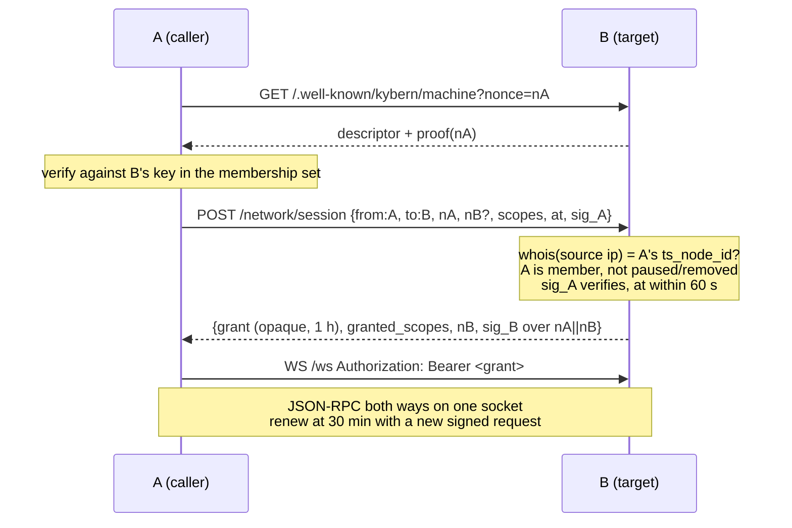
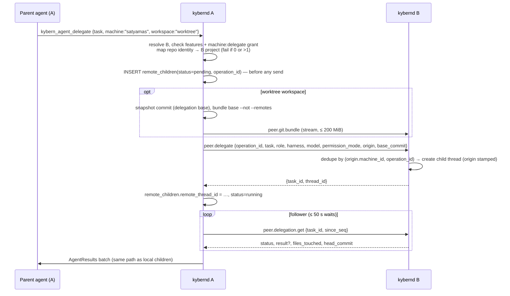
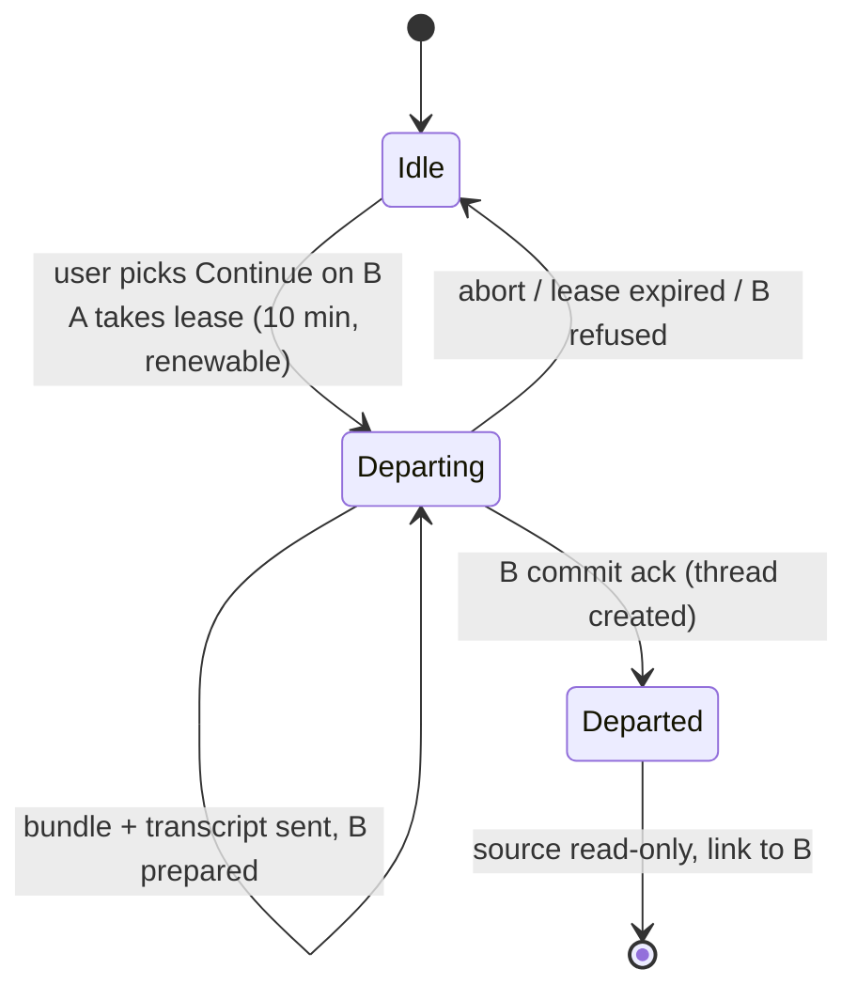

# Machine network (ADE-86)

Status: design, 2026-10-28. Base: `main` at `d4f84024c`.
Decisions: `.kybern-artifacts/ade-86/DECISIONS.md` (grilled 2026-10-28). Every
bullet there is settled. This document says how to build them. Where a
mechanism here goes further than the decision's wording, it is called out as an
**interpretation**.

Implementation lanes should be able to build from this document without asking
the user again. Section 12 lists the few questions that only the user can
answer. Until the user answers, lanes follow the recommended default.

## Contents

1. Goals, non-goals, glossary
2. Identity and membership
3. Transport and routing
4. Protocol
5. Client merge (M1)
6. M2 Run elsewhere
7. M3 Fork to a machine, then Continue on…
8. M4 Utilities
9. M5 Shared state and the login broker
10. Cross-platform, resource budget, observability
11. Build plan
12. Open questions
13. Prior art (as of 2026-10-28, t3code `5211acfe`)

---

## 1. Goals, non-goals, glossary

### Goals

- The user's own machines form a network: the Mac, the Windows PC
  `satyamas`, the VPS and the CachyOS box. They join it once and leave it once,
  and that happens everywhere at the same moment.
- One app, desktop or phone, shows every machine's projects and threads in a
  single list. One pairing is enough for the app to drive all of them.
- Work can run on any machine: new threads, delegated agents, agent tools,
  terminals, files, clipboard and preview ports. Each capability is gated
  separately, the permission mode can only narrow, and every action records
  where it came from.
- An offline machine stays visible from cache, and work sent to it waits in a
  visible outbox.
- The user signs in to each harness once, through the login broker (M5).
- Milestones: M1 Network → M2 Run elsewhere → M3 Fork / Continue on → M4
  Utilities → M5 Shared state. M1 is built first. M2–M5 are built in parallel
  lanes and ship together.

### Non-goals (v1)

- **Multi-user.** One owner only. No sharing with other people, no roles, no
  team tailnets as a supported setup.
- **A hosted relay or any Kybern cloud service.** Relays are the user's own
  member machines.
- **CRDT or replicated thread state.** Each daemon owns and is the only writer
  of its projects, threads, notes and tasks. The membership set (§2.3) is
  signed operations plus last-writer registers. It is not thread state.
- **LAN-only links.** Daemon-to-daemon traffic needs Tailscale in v1. A direct
  LAN route between machines that are already members comes later, as a
  faster route only.
- Auto-balancing work across machines (later).
- Moving a harness's native session between machines. A moved or forked thread
  starts a fresh native session from a hand-off note.

### Glossary

| Term | Meaning |
| --- | --- |
| **Machine** | One `kybernd` install. Its id is the existing `environment_id` (UUIDv7, `meta.environment_id`, `state.rs:93`), and it has a machine key. The UI says "machine". |
| **Network** | The set of machines that belong to the owner. It has a `network_id`, set by the first membership operation. In explanations the UI calls it "your network". |
| **Member** | A machine with a valid, unrevoked Add in the membership set. Phones are never members; they are clients. |
| **Client** | GPUIX, mobile or the CLI. It holds one connection per machine. |
| **Route** | One way for a client or daemon to reach a machine: a tailnet address, an advertised HTTPS URL, an SSH tunnel, or a relay through another member. |
| **Grant** | A short-lived bearer credential that one machine issues to another for a daemon-to-daemon session. It carries machine scopes (§4.2). |
| **Origin** | An immutable record on work that another machine started: origin machine, thread, operation id, permission cap and hop chain. Only a daemon sets it. |
| **Outbox** | The durable per-daemon queue of operations bound for a machine that is offline or paused. Users can see it. |
| **Broker** | The always-on machine that holds the rotating harness logins and lends short-lived access tokens (M5). The VPS by default. |
| **Inbound thread** | A hidden, read-only thread on the target that records the forwarded tool calls from one origin thread, plus their approvals (§6.3). |

---

## 2. Identity and membership

### 2.1 Keys

Each machine has two long-lived key pairs, created the first time the network
code starts:

- **Machine signing key** (Ed25519). It signs membership operations,
  handshake challenges and well-known proofs.
- **Machine sealing key** (X25519). Secrets, borrowed tokens and pushed keys
  are sealed to it (XChaCha20-Poly1305 sealed box), so a relay cannot read
  them.

Crates: `ed25519-dalek`, `x25519-dalek`, `chacha20poly1305` (or `crypto_box`).
None of them is in `Cargo.lock` yet. Check each on socket.dev or the RustSec
advisory database before adding it. `hkdf`, `ring` and `rustls` are already
there.

Storage, under `<data_dir>/network/`:

| OS | Where the private keys live |
| --- | --- |
| macOS | `machine.key`, mode 0600. It sits next to `daemon.token`, which already has this trust level. The daemon runs headless under launchd or the desktop, and Keychain prompts would block it there. Moving it to the Keychain is a later option. |
| Linux | `machine.key`, 0600. Most VPS and headless boxes have no Secret Service. |
| Windows | `machine.key`, wrapped with DPAPI (`CryptProtectData`, user scope) and an ACL that admits only the user. `cfg(windows)`. |

The public keys and their fingerprint, the first 16 hex characters of the
SHA-256 of the signing key, are kept in `meta`. Rotation only happens through
"Rejoin" (§2.6). A new key means a new membership.

### 2.2 Owner

**Interpretation of "membership is owner-signed".** There is one owner: the
user. The owner's signature is a signature by any current member's machine
key. Every member acts for the owner. Operations go into a hash-identified
membership set that every member holds in full. We do not keep one shared
"owner private key" on every machine, for three reasons:

- a stolen laptop would keep the power to sign after it was removed, until
  someone rotated the key;
- rotation needs every member online;
- removal is simpler and lasts longer when the removed key is just tombstoned.

The intent of the decision still holds: only the owner's machines can change
membership, every change is signed, and changes spread to every member.

The first operation, `Genesis`, records the owner's Tailscale identity: the
`UserProfile.LoginName` of the founding node, plus the tailnet name from
`CurrentTailnet.Name`. Auto-join (§2.4) compares other machines against that
identity.

### 2.3 The membership set

Operations are grow-only. Each one is a signed envelope:

```text
OpEnvelope {
  id:        sha256(body)           // hex; the primary key
  body:      bytes                  // the exact signed JSON text, never re-serialized
  signer:    machine_id
  signature: ed25519(signer, "kybern-network-op-v1\0" || body)
}
body (JSON): { v: 1, network_id, kind, at, lamport, ...kind fields }
```

| Kind | Fields | Effect |
| --- | --- | --- |
| `genesis` | `owner_login`, `tailnet`, `machine` (descriptor) | Creates the network. The signer is the first member. |
| `add` | `machine` (id, signing and sealing public keys, name, `ts_node_id`, `ts_name`, `os`), `via` (`auto`, `found`, `code`, `migrate`) | Adds a member. |
| `remove` | `machine_id`, `ts_node_id`, `reason` (`user`, `stolen`, `rejoin`) | Removes a member permanently. It tombstones the key **and** the Tailscale node id. |
| `set` | `key`, `value` | A last-writer register. Keys: `machine.<id>.name`, `machine.<id>.paused`, `broker`, `follow_updates`, `allow.<id>.<capability>`. |
| `merge` | `other_network_id`, `other_genesis` | Joins two networks of the same owner (§2.4). |

Rules:

- **Valid Add:** it is signed by the genesis signer, or by a machine that has a
  valid Add. Validity is checked recursively from genesis and has no cycles,
  because a signer's own Add must already be in the set.
- **Member:** a machine with a valid Add and no Remove signed by any machine
  that ever had a valid Add. Removal wins and is permanent. Getting back in
  needs a **new machine key** (Rejoin).
- **Registers:** the highest `(lamport, signer)` wins. `lamport` is
  `max(seen) + 1` when the op is created. Wall-clock `at` is only for display.
- **Unknown kinds** are kept, verified, gossiped and otherwise ignored. That
  gives forward compatibility.
- **Tamper:** an envelope with a bad signature, a signer that is not a member,
  or a mismatched `id` is dropped and logged under `kybern::network`. The
  sender's session is closed.
- **Rollback:** the set only grows and every member keeps every op. A peer
  that offers an old copy cannot undo a Remove. A peer whose set lacks a
  Remove we hold gets it on the next sync. A removed machine's own operations
  after its removal are still accepted as data, because Adds it signed earlier
  may be legitimate. The UI shows "added by <machine>" so the user can clean
  up (§2.6).

Sync: when a session opens, both sides compare a digest, the SHA-256 of the
sorted op ids. If the digests differ, each side sends the ids it has and the
other pulls what it is missing (`peer.ops.sync`). New ops are pushed to every
connected member right away (`peer.ops.push`) and re-gossiped once. The set is
small: tens of ops, under 64 KiB.

Store: `network_ops` (§4.4). The member list is a projection over it, rebuilt
on start and after every new op.

### 2.4 Joining

There are three ways in. All of them end with an `add` op, and the
well-known proof (§3.2) has to succeed first.

**a. Same Tailscale user (zero clicks).** On each discovery tick (§3.1), a
member A checks every online tailnet peer P that answers the well-known
endpoint and is not yet a member:

1. A runs `tailscale whois --json <P ip>`. Auto-join applies only when P is
   untagged, P's user `LoginName` equals the network's `owner_login`, and P is
   not a shared-in node (its `Node.Sharer` is empty and it sits in the same
   tailnet).
2. A sends `POST /network/offer` to P. The offer contains a fresh nonce, A's
   descriptor, the full op set, and an `add` op for P that A has signed in
   advance. That op uses the keys P published in its well-known proof.
3. P checks the other direction: it runs `tailscale whois` on the source
   address of the connection. A must be untagged and belong to P's own node
   user, A's descriptor must match the signed op set, and P must not be in a
   network already. If all of that holds, P stores the set and answers with
   its own signature over the nonce.
4. A gossips the `add` op, and every member sees the new machine.

If P is already in a network:

- Same owner, different `network_id`: both sides show "satyamas is in another
  of your networks · Merge". This only happens if two pairs formed while the
  machines could not see each other. One click on either side writes a
  `merge` op, signed by a member of each network.
- Different owner: P is not shown at all.

Genesis is lazy. A lone machine has no network. The first time two
same-owner machines meet, the one with the smaller `machine_id` founds the
network, so two founders cannot race.

**b. Tagged or shared nodes ("Found satyamas on your tailnet · Add").** P
answers well-known but is tagged (a VPS with `tag:server`, say), shared in, or
owned by someone else. Every member's Settings → Machines lists it under
**Found on your tailnet**. Add on any member sends the same offer, and P
accepts it without a code when **all** of these hold:

- P is not in a network yet;
- P's own node is tagged and owned by the same tailnet as A
  (`CurrentTailnet.Name` matches);
- A is an untagged node of a user in that tailnet;
- the tailnet has one human user. Count the distinct non-tagged `UserID`s
  among the non-shared peers in `tailscale status --json`.

When any check fails (a shared-in node, a team tailnet, a different tailnet),
Add opens the code flow. The only change the user sees is "Enter the code
shown on satyamas". This is the safe form of "one click on any member": one
click wherever the target can verify the clicker.

**c. Off-tailnet machines (6-digit code or QR).**

- The joining machine B runs `kybern machines code` or `kybernd --pair
  --machine`, or opens Settings → Machines → "Join a network" if it has a
  desktop. B shows a six-digit code and its reachable addresses, as QR
  `kybern://join?url=…&code=…&machine=<id>`. The codes come from `access.rs`
  `Pairing` with a new `purpose: Machine`. Same rules: 10 minutes, 5 tries a
  minute, 128 pending.
- On any member, "Add by code" takes the code and B's address. If B is on the
  tailnet, the member also tries B's tailnet address.
- The member calls `POST /network/join-by-code` on B with the code, its offer,
  and its own signing key. B checks the code, verifies the well-known proof
  of A's address the other way (§3.2), then stores the set and signs.
- A B that is off the tailnet is an **outbound-dialed member**. It has no
  inbound path, so it keeps one persistent session to a reachable member,
  chosen as the VPS or another member with an advertised HTTPS URL. Every
  other member reaches B through that relay (§3.4). v1 does not add LAN
  routes.

**d. Migration.** For environments already saved in GPUIX
(`environments.json`) or mobile:

- If the client holds a device token for daemon B and B is new enough, the
  client offers "Add satyamas to your network". The client asks A for a
  one-time join code (`network.code.create`, the same flow as c) and redeems it
  on B with `network.join` over its existing connection to B.
- This needs a scope that paired desktops get when they upgrade:
  `network:admin` (§4.2).
- The `add` op is recorded with `via: migrate`.

A newly joined machine runs one check of harness sign-ins (§9.4). Each
harness that is not signed in shows "Claude isn't signed in here · Sign in"
on that machine's card and in the composer picker.

### 2.5 Removal

"Remove" on any member, or on any client with `network:admin`, writes a
`remove` op that is signed by a member and gossiped right away. Each member
that receives it:

1. closes every session with the removed machine and refuses its key and
   Tailscale node id from then on, including for well-known offers;
2. revokes every grant it issued to that machine or holds from it, and every
   relay route through it;
3. cancels outbox items addressed to it (state `cancelled`, reason "machine
   removed") and marks remote children on it `unreachable` (§6.2);
4. as broker, stops lending to it. Access tokens it already borrowed expire on
   their own (≤ 1 h by policy, §9.4). Anthropic and OpenAI access tokens
   cannot be recalled early.

Clients drop that machine's connection, its cached lists and the device token
for it. Device tokens issued **by** the removed machine to the user's clients
die with it.

On the removed machine itself, if it is still cooperating: when it receives
the op, or finds every session refused, it deletes `network/`, its op set,
cached grants, borrowed tokens and every secret it got through the secret
store. Then it becomes a lone machine with a new key. A stolen machine will
not cooperate, so:

- **Remove → "This machine might be lost or stolen"** writes `reason: stolen`.
  The dialog then lists:
  - the machines this one added after it last talked to you, each with
    "Remove these too";
  - the keys pushed to it through the secret store, each with "Rotate this key
    at its provider";
  - a link to the Tailscale admin console to remove the node or lock it (see
    the threat model).
- Settings → Machines warns while a removed node still shows up in
  `tailscale status`.

**Pause** is the `machine.<id>.paused` register:

- Peers keep syncing ops with a paused machine but open no other sessions to
  it.
- Composer pickers skip it, and clients do not keep a live connection to it.
  Its cached lists stay visible with a "Paused" label.
- Work for it waits in the outbox.
- Resume clears the flag.

### 2.6 Rejoin

A machine that was removed by mistake shows "This machine was removed from
your network · Rejoin" in its own Settings. Rejoin makes a new machine key and
`machine_id`. Its projects and threads keep their ids, because ownership is
per daemon.

The machine id has to change because its `environment_id` is tombstoned. The
store keeps the old id as `meta.previous_machine_ids`, so clients can
re-attach cached data.

Auto-join never applies after a removal, because the Tailscale node id is
tombstoned too. Another member must click Add, which writes `via: found` with
`reason: rejoin` in the UI.

### 2.7 Threat model

| Threat | What limits it |
| --- | --- |
| **Stolen or lost laptop, unlocked.** The attacker has a member key and a running daemon. | Removal from any other member takes effect everywhere at the next sync. The "lost or stolen" flow removes the machines it added and lists keys to rotate. Grants last at most 1 h, so sessions to it die within the hour. Borrowed tokens last at most 1 h. **Tailscale removal is the real fence.** As long as the laptop is still on the tailnet, it can reach every daemon's well-known endpoint, though it can no longer get a session. Kybern says this and links to the admin console. Tailnet lock is recommended in the doctor output. |
| **Stolen laptop, locked or powered off.** | The disk holds `machine.key` (0600 or DPAPI) and device tokens in the Keychain. FileVault or BitLocker is the user's defense. Remove it anyway. |
| **Prompt injection on one machine.** An agent on A is told to wreck B. | Forwarded calls carry the caller's permission mode and can only narrow it (§6.3). Below Full access, inbound work is fenced: it may touch only threads it created, and may not change projects, settings, network membership, the broker or secrets. There are no onward hops in v1. Consent prompts appear on B for computer use, secrets, notes and tasks, login use and destructive file actions. Every call is written to B's inbound thread with its origin, so the user can audit it. Each capability scope can be turned off per machine. Agents cannot add or remove machines: there is no agent tool for it. |
| **Shared-in tailnet node, or another user on the tailnet.** | Auto-join and the codeless Add need both sides to see the owner's own untagged user via `whois`. Anything else needs a code. Well-known answers only with public data: id, name, version, features, public keys and a signature over the caller's nonce. It never sends credentials. A daemon sends no credential until the peer has proven the expected key (§3.2). |
| **Replay.** | Handshakes sign a fresh 32-byte nonce from each side, bound to both machine ids, the tailnet addresses and a 60 s timestamp window. Ops are deduplicated by content hash. Grants are bound to the holder's machine id and source tailnet IP. Operation ids are namespaced by origin (§6.2), so replaying a delegate call returns the first result. |
| **Malicious relay member.** | Relays are members, and members are trusted. Even so, secrets and borrowed tokens are sealed end to end to the target's sealing key, and a relay cannot mint grants for another machine. |
| **Compromised harness CLI on one machine.** | Out of scope. The same exposure exists today. |

---

## 3. Transport and routing

### 3.1 Discovery over the tailnet

`network/tailscale.rs` wraps the CLI behind a `Tailscale` trait. That trait is
the seam the multi-daemon harness fakes (§11.3). Its methods:

- `status() -> Status` uses `tailscale status --json`, with peers this time.
  Today's `--peers=false` call in `discovery.rs:80` stays as it is.
- `whois(addr) -> Whois` uses `tailscale whois --json <ip[:port]>`, cached for
  60 s per address.
- `self_ip()` reuses `discovery::tailscale_ip`.

The CLI path is resolved the same way `discovery.rs::tailscale` does it today,
plus `C:\Program Files\Tailscale\tailscale.exe` on Windows and
`/opt/homebrew/bin/tailscale` and `/usr/local/bin/tailscale` on macOS.

Ticks:

- every 60 s while a client shows Settings → Machines or the "Found" list;
- every 5 min otherwise;
- once on start and once after any session drops.

Each tick probes only online peers that are not members and are not
tombstoned. It sends `GET http://<peer-ts-ip>:<network port>/.well-known/kybern/machine`,
with a 3 s timeout and at most 8 probes at once. Results are cached for 10 min
per node id.

**Network port.** While the network is on, the Tailscale listener binds a
fixed `network.port`: `settings.network.port`, default `DEFAULT_PORT` 4173. It
does not bind the loopback port, which may be the desktop's random port
(`desktop_listen_port`). Peers can find each other only if they agree on the
port. If 4173 is taken on the Tailscale address, the daemon tries 4174–4179
and publishes the port it got in its `add` descriptor. Peers that are not
members yet are probed on 4173–4179, in order, stopping at the first answer.
`exposure.rs` gets a second, port-stable listener mode, and the existing
`access.tailscale` toggle becomes part of "Network on".

**Network on by default.** For fresh installs and upgrades, "Connect to your
other machines" is on whenever Tailscale is running. A one-time notice
appears in the sidebar footer and in Settings → Machines. See §12 Q1.

### 3.2 Identity check before any credential

`GET /.well-known/kybern/machine?nonce=<32B b64url>` needs no authentication.
It answers with:

```json
{ "machine_id": "...", "name": "satyamas", "os": "windows", "arch": "x86_64",
  "version": "0.19.0", "network_protocol": 1, "features": ["network.v1", "..."],
  "signing_key": "<b64>", "sealing_key": "<b64>", "network_id": "..."|null,
  "ts_name": "satyamas.tail-abc.ts.net", "at": "2026-10-28T10:00:00Z",
  "proof": "<ed25519 over 'kybern-wk-v1\0' || nonce || machine_id || at || host-as-requested>" }
```

Rules, for daemons and clients alike:

- **Never send a token, grant or offer to an address until the well-known
  check passes**:
  - the signature verifies against the **expected** key, taken from the
    membership set or from the client's saved machine record;
  - the nonce matches;
  - `at` is within 60 s.

  A self-reported `machine_id` alone never attaches a route to a saved
  machine. That is t3code #26178's fix, adopted here.
- Probe timeouts: 3 s for loopback, 10 s otherwise (t3code's values).
- `/.well-known` is rate-limited to 30 requests per minute per source address.
- The endpoint is served on every listener, so clients can verify routes too.

### 3.3 Daemon-to-daemon sessions



The grant:

- is a `kyb_m_…` random token; only its hash is stored in memory;
- is bound to the holder's `machine_id` and source tailnet IP;
- lasts 1 h and renews after 30 min;
- is never persisted, so it does not survive a restart.

`ws.rs` gains a principal kind:

```rust
pub enum PrincipalKind { Device, Machine { machine_id: String, origin_ip: IpAddr } }
```

`authenticate` checks the machine grant table before the token store. A grant
whose machine was removed, or paused (for anything other than
`machine:peer`), is refused at use time, the same way `token_is_active` works
today.

**One session per pair, used both ways.** The member with the smaller id
dials. The socket carries requests in both directions: the dialer's `Client`
and the listener's `ConnectionCtx` both route `peer.*` calls. Heartbeat is a
WebSocket ping every 30 s. Three missed pings mark the peer offline.
Reconnects back off at 2, 4, 8 … 300 s and reset when tailnet status changes.

Scopes are requested per capability and granted per the target's policy:
`allow.<caller>.<capability>` registers, all on by default except
`clipboard_auto`. The full list is in §4.2.

**Plain HTTP rules:**

- daemon to daemon: `http`/`ws` only to an address in `100.64.0.0/10` or
  `fd7a:115c:a1e0::/48` whose `whois` resolves to the expected node. Anything
  else must be `https`/`wss`;
- client to daemon: the current `pairing.rs::kind` rules apply. Loopback,
  Tailscale and private networks may use plain HTTP, and public addresses
  must use HTTPS or an encrypted tunnel;
- relays may forward plain WebSocket only over tailnet hops.

### 3.4 Clients and many daemons; relays

A client keeps a `MachineConnection` per machine (§5.1), and each connection
has an ordered list of candidate routes:

1. **Direct tailnet** `ws://<ts-ip>:<port>/ws`, when the client is on the
   tailnet, for example the desktop.
2. **Direct advertised** `wss://…`, from `--advertise-url` or Tailscale Serve
   HTTPS.
3. **Saved SSH tunnel**, from the old environment profile. This route type
   stays for machines reachable only over SSH.
4. **Relay via member M**: `<M route>/relay/<machine_id>/ws`. M is the machine
   the client is connected to with the lowest latency.

The client tries routes in order. Each attempt verifies well-known first
(§3.2), then authenticates with its **device token for that machine**. The
first route that works is kept. Every 5 min, and when the OS reports a network
change, the client probes the better routes ahead of the current one and moves
to the first that works, without dropping subscriptions. It reconnects and
then replays, as `KybernClient` already does.

**How a client gets a token for every machine (one pairing).** The client
pairs with any member A. Then:

1. The client calls `network.client_grant { machine_id: B, device_id }` on A.
2. A calls `peer.client_token.mint` on B over the daemon session. B creates a
   long-lived device token (`tokens` row) with scopes `Scope::CLIENT` plus
   `network:read`, labelled "<device> (via <A>)", with `device_id` and
   `issued_via` set. B returns it **sealed to A's key**. A unseals it and
   returns it to the client over the client's authenticated socket.
3. The client stores it in its credential store, keyed by machine id.

A `device_id` is assigned when the device first pairs. Revoking the device on
any machine (Settings → Paired devices) gossips `peer.device.revoke` and
revokes that device's token on every member. Clients mint tokens lazily, the
first time they need a machine, and refresh after a removal or Rejoin.

**The relay endpoint.** `GET /relay/{machine_id}/ws` (WebSocket upgrade) and
`ANY /relay/{machine_id}/http/{*path}`, for previews, assets and uploads:

- The caller authenticates to M with any device token that has
  `orchestration:read`. M checks that the target is a member with an open
  daemon session that has `machine:relay`.
- M forwards frames over a **multiplexed stream on the existing session**:
  `peer.relay.open` / `.data` / `.close`, binary frames with per-stream ids and
  a credit window of 256 KiB per stream.
- The client's own `Authorization` and ticket travel end to end and are
  checked by B. M strips its own headers.
- Limits: 32 relayed streams per client and 256 per daemon. Idle streams close
  after 30 s, except the main `/ws` stream, which follows heartbeats.
- B sees the relayed connection's principal as the client device, never as M.

### 3.5 Route preference and failover summary

| From → to | Preference |
| --- | --- |
| Daemon → member | Direct tailnet → relay via that member's dial-out host (outbound-dialed members only) |
| Desktop → machine | Direct tailnet → advertised HTTPS → SSH tunnel → relay |
| Phone → machine | Direct tailnet (phone on Tailscale) → advertised HTTPS → relay via the paired member |

A machine is **online** when some route works, **relaying** when only a relay
route works (shown as such in Settings → Machines), and **offline** otherwise.

---

## 4. Protocol

Every method follows "Adding an RPC method" in `AGENTS.md`:

1. a struct pair and `method!` in `crates/kybern-protocol/src/methods.rs`;
2. the method added to `registry!` (`methods.rs:3951`) and to
   `bin/schema.rs`;
3. a handler in `crates/kybern-daemon/src/rpc.rs`;
4. a CLI subcommand (`kybern machines …`);
5. the types and the `Methods` entry mirrored in
   `packages/kybern-client/src/types.ts`.

Payload types go in a new `crates/kybern-protocol/src/network.rs`, re-exported
from `lib.rs`. Protocol snapshots change on purpose. Review the diff, then
`INSTA_UPDATE=always cargo test -p kybern-protocol`.

### 4.1 Methods

Client-facing methods are called by GPUIX, mobile and the CLI with device or
bootstrap tokens.

| Method | Scope | Params → Result | Notes |
| --- | --- | --- | --- |
| `network.status` | `network:read` | `{}` → `NetworkStatus { enabled, network_id?, self_machine, members: [MachineCard], found: [FoundMachine], outbox: OutboxSummary, broker?, tailscale: TailscaleState }` | Everything Settings → Machines needs, in one call. |
| `network.set_enabled` | `network:admin` | `{ enabled }` → `NetworkStatus` | The master toggle. Off leaves the network but keeps membership. |
| `network.add` | `network:admin` | `{ found_id }` → `AddResult { machine?: MachineCard, needs_code: bool }` | One-click Add. |
| `network.code.create` | `network:admin` | `{}` → `{ code, expires_at, endpoints, qr }` | Run on the joining machine. |
| `network.join` | `network:admin` | `{ code, address }` → `MachineCard` | Run on a member with the joining machine's code. |
| `network.remove` | `network:admin` | `{ machine_id, stolen: bool, also_remove: [machine_id] }` → `NetworkStatus` | |
| `network.pause` | `network:admin` | `{ machine_id, paused }` → `MachineCard` | |
| `network.rename` | `network:admin` | `{ machine_id, name }` → `MachineCard` | |
| `network.merge` | `network:admin` | `{ found_id }` → `NetworkStatus` | |
| `network.rejoin` | `network:admin` | `{}` → `NetworkStatus` | Only on a removed machine. |
| `network.client_grant` | `network:read` | `{ machine_id, device_id }` → `{ token, scopes, routes: [Route] }` | §3.4. |
| `network.routes` | `network:read` | `{ machine_id }` → `{ routes: [Route] }` | |
| `network.allow.set` | `network:admin` | `{ machine_id, capability, allowed }` → `MachineCard` | Policy for the target. It is a register signed by the target's own key. |
| `network.update_all` | `network:admin` | `{}` → `{ started: [machine_id], skipped: [{machine_id, reason}] }` | Fans `daemon_update.run` out to members. A desktop-managed daemon is skipped with "Updates with the app". |
| `network.doctor` | `network:read` | `{ machine_id? }` → `DoctorReport` | §10.3. |
| `outbox.list` | `orchestration:read` | `{ target?, state? }` → `{ items: [OutboxItem] }` | |
| `outbox.retry` / `outbox.cancel` | `orchestration:operate` | `{ id }` → `OutboxItem` | |
| `outbox.enqueue` | `orchestration:operate` | `{ target, operation: OutboxOp }` → `OutboxItem` | A client queues work for an offline machine on a reachable member (§6.4). |
| `machines.info` | `network:read` | `{}` → `MachineInfo { cpu, gpu, mem, harnesses: [ProviderStatus summary], projects: [RepoIdentity] }` | Per-machine data for the Machines page. Each machine serves it about itself. |

Daemon-to-daemon methods (`peer.*`) are refused unless the principal is
`Machine`:

| Method | Machine scope | Purpose |
| --- | --- | --- |
| `peer.ops.sync` / `peer.ops.push` | `machine:peer` | Membership set (§2.3). |
| `peer.presence` | `machine:peer` | Version, features, load, battery, harness summary. Pushed on change and with the heartbeat. |
| `peer.client_token.mint` / `peer.device.revoke` | `machine:peer` | §3.4. |
| `peer.relay.open/data/close` | `machine:relay` | §3.4. |
| `peer.delegate` / `peer.delegation.get` / `peer.delegation.cancel` | `machine:delegate` | §6.2. |
| `peer.thread.create` / `peer.thread.send` | `machine:delegate` | Outbox delivery and composer sends routed by a daemon. |
| `peer.tool.call` | `machine:tools` | §6.3. |
| `peer.git.bundle` / `peer.git.import` | `machine:delegate` | §6.2 and §7. Streamed. |
| `peer.files.push` | `machine:files` | §8.1. |
| `peer.clipboard.set` / `peer.clipboard.get` | `machine:clipboard` | §8.2. |
| `peer.ports.open` | `machine:ports` | §8.3. |
| `peer.settings.patch` | `machine:settings` | §9.1. |
| `peer.secrets.put` | `machine:secrets` | §9.3. |
| `peer.login.borrow` / `peer.login.status` | `machine:logins` | §9.4. |
| `peer.move.prepare/commit/abort` | `machine:delegate` | §7.2 leases. |

New notifications:

- `network.changed` (`NetworkStatus`)
- `network.machine.changed` (`MachineCard`)
- `outbox.changed` (`OutboxItem`)
- `peer.thread.events`: a daemon-only subscription stream used by the
  follower (§6.2). It reuses `events.subscribe` semantics on the target.

The new `kybern://` link shapes:

- `kybern://thread/<machine_id>/<thread_id>`. The old `kybern://thread/<id>`
  keeps resolving on the local machine. This is adopted from t3code #26239.
- `kybern://machine/<machine_id>`.

### 4.2 Scopes

Added to `Scope` in `crates/kybern-protocol/src/auth.rs`.

For clients:

- `network:read`: added to `Scope::CLIENT`.
- `network:admin`: in `Scope::ALL`, so bootstrap tokens have it. It is also
  given to desktop pairings, and to phone pairings, because "removing anywhere"
  includes the phone. Tokens paired before this change get it on upgrade only
  for labels that are not phones.

For machines, only grants carry these, never device tokens:

| Scope | Allows | Default |
| --- | --- | --- |
| `machine:peer` | Op sync, presence, device token minting | always |
| `machine:relay` | Relaying clients to this machine | on |
| `machine:delegate` | New threads, delegations, sends, git bundles, move leases | on |
| `machine:tools` | Forwarded agent tools (§6.3) | on |
| `machine:terminals` | `kybern_run_in_terminal`, `read_terminal` forwarded | on |
| `machine:files` | File reads, writes and pushes from other machines | on |
| `machine:clipboard` | Explicit clipboard send and paste | on |
| `machine:clipboard_auto` | Universal clipboard | **off** (opt-in) |
| `machine:ports` | Port forwarding to this machine's loopback | on |
| `machine:settings` | Settings fan-out | on |
| `machine:secrets` | Receiving pushed keys | on |
| `machine:logins` | Borrowing from this broker | on (broker only) |

`machine:tools` covers the read and operate tools in §6.3. Terminals and files
also need their own scope, so that turning off "files" on the VPS stops
`kybern_read_file` there too. Computer use, secrets, notes/tasks consent and
login use are never default-allowed for remote origins: they always ask on
the target.

### 4.3 Version negotiation and features

- `PROTOCOL_VERSION` stays `1`. Everything here is additive.
- `DaemonInfo` gains these fields (all `serde(default)`): `machine_id` (equal
  to `environment_id`), `network_protocol: u32` (starting at 1), and
  `features: Vec<String>`.
- The features: `network.v1`, `relay.v1`, `delegate.remote.v1`,
  `tools.forward.v1`, `fork.v1`, `move.v1`, `files.push.v1`, `clipboard.v1`,
  `ports.v1`, `settings.fanout.v1`, `notes.federated.v1`, `secrets.store.v1`,
  `login.broker.v1`.
- Peers and clients check features before they offer an action. A missing
  feature shows inline: "satyamas needs Kybern 0.20 for this · Update".
- `peer.presence` repeats the version and features, so an update shows up
  without reconnecting.
- A member with a lower `network_protocol` keeps working for every feature it
  lists. Ops it does not understand are kept (§2.3).
- A daemon older than M1, still reachable through a client's saved
  environment, appears in the client's merged list as a machine marked "Not in
  your network · Update to add". The lists merge (§5), and daemon-to-daemon
  features are off for it.

### 4.4 Store migrations

These are appended to `MIGRATIONS` in `crates/kybern-store/src/schema.rs`,
which is at v31 today. Each block is `BEGIN … COMMIT` and is never edited
after it merges. Each milestone appends its own migration, so parallel lanes
must take version numbers in merge order: rebase and renumber before merging.
They never edit someone else's block.

**v32 (M1) network.**

```sql
CREATE TABLE network_ops (
  id TEXT PRIMARY KEY,            -- sha256(body) hex
  body BLOB NOT NULL,             -- exact signed bytes
  signer TEXT NOT NULL,
  signature BLOB NOT NULL,
  kind TEXT NOT NULL,
  lamport INTEGER NOT NULL,
  received_at TEXT NOT NULL
);
CREATE TABLE network_machines (   -- cache of peer descriptors and last presence; rebuilt from ops + presence
  machine_id TEXT PRIMARY KEY,
  descriptor TEXT NOT NULL,       -- JSON: keys, name, os, ts_node_id, ts_name, port
  presence TEXT,                  -- JSON: version, features, harnesses, load
  last_seen_at TEXT
);
ALTER TABLE projects ADD COLUMN repo_identity TEXT;   -- JSON RepoIdentity, refreshed with Git status
ALTER TABLE tokens ADD COLUMN device_id TEXT;
ALTER TABLE tokens ADD COLUMN issued_via TEXT;   -- machine id that requested a cross-machine device token
CREATE INDEX tokens_device ON tokens(device_id);
```

**v33 (M2) outbox, origins, remote children.**

```sql
CREATE TABLE outbox (
  id TEXT PRIMARY KEY,
  operation_id TEXT NOT NULL UNIQUE,
  target TEXT NOT NULL,           -- machine id
  kind TEXT NOT NULL,             -- thread_create | thread_send | delegate | files_push | settings_patch | secrets_put | fork
  payload TEXT NOT NULL,          -- JSON
  origin TEXT,                    -- JSON Origin
  state TEXT NOT NULL CHECK (state IN ('queued','sending','delivered','failed','expired','cancelled')),
  attempts INTEGER NOT NULL DEFAULT 0,
  next_attempt_at TEXT,
  last_error TEXT,
  result TEXT,
  created_at TEXT NOT NULL,
  expires_at TEXT NOT NULL,
  updated_at TEXT NOT NULL
);
CREATE INDEX outbox_due ON outbox(state, next_attempt_at);
ALTER TABLE threads ADD COLUMN origin TEXT;      -- JSON Origin; immutable once set
ALTER TABLE threads ADD COLUMN inbound TEXT;     -- JSON InboundInfo for inbound audit threads
CREATE TABLE remote_children (
  task_id TEXT PRIMARY KEY,
  operation_id TEXT NOT NULL UNIQUE,
  parent_thread_id TEXT NOT NULL REFERENCES threads(id) ON DELETE CASCADE,
  target TEXT NOT NULL,
  remote_thread_id TEXT,          -- NULL until the target acknowledged
  status TEXT NOT NULL,           -- pending | running | completed | failed | cancelled | unreachable
  stop_requested INTEGER NOT NULL DEFAULT 0,
  last_seq INTEGER NOT NULL DEFAULT 0,
  info TEXT NOT NULL,             -- JSON DelegationInfo mirror (result, files_touched, branch, head)
  created_at TEXT NOT NULL,
  updated_at TEXT NOT NULL
);
```

**v34 (M3) moves.**

```sql
ALTER TABLE threads ADD COLUMN moved TEXT;   -- JSON MoveInfo { state: departing|departed|arrived, peer, peer_thread_id, lease_until, operation_id }
```

**v35 (M5) secret store and broker.**

```sql
CREATE TABLE secrets (
  name TEXT PRIMARY KEY,          -- e.g. provider.opencode.OPENAI_API_KEY
  ciphertext BLOB NOT NULL,
  nonce BLOB NOT NULL,
  key_version INTEGER NOT NULL,
  source TEXT NOT NULL,           -- local | pushed:<machine_id>
  updated_at TEXT NOT NULL
);
CREATE TABLE broker_loans (
  id TEXT PRIMARY KEY,
  borrower TEXT NOT NULL,
  provider TEXT NOT NULL,
  account TEXT NOT NULL,
  expires_at TEXT NOT NULL,
  created_at TEXT NOT NULL
);
```

The `Project` wire type gains `repo: Option<RepoIdentity { root_commit:
Option<String>, remote: Option<String> }>`, computed at the next Git refresh and
cached in the `projects.repo_identity` column (v32):

- `root_commit` is the smallest hash in `git rev-list --max-parents=0 HEAD`.
- `remote` is the `origin` URL normalized to `host/owner/repo`: lowercase,
  with no scheme, user or `.git`.
- For group projects, each member has its own identity, and the group has the
  sorted list.

`Thread` gains these optional fields: `origin: Option<Origin>`,
`inbound: Option<InboundInfo>` and `moved: Option<MoveInfo>`.

```rust
pub struct Origin {
    pub machine_id: String,
    pub machine_name: String,
    pub thread_id: Option<ThreadId>,
    pub operation_id: Uuid,
    pub kind: OriginKind,            // Composer | Delegation { task_id } | ToolCall | Fork | Move
    pub permission_cap: PermissionMode,
    pub hops: Vec<String>,           // machine ids, oldest first; len ≤ 1 in v1
}
```

---

## 5. Client merge (M1)

### 5.1 Shared machine set: `packages/kybern-client/src/machines.ts`

A new module that GPUIX and mobile both import:

```ts
export interface MachineRecord {          // persisted per client
  machineId: string; name: string; os?: string
  routes: Route[]; signingKey?: string     // pinned from the first verified well-known
  member: boolean; paused?: boolean; legacyProfileId?: string
}
export interface MachineConnection {
  record: MachineRecord
  client: KybernClient                     // one per machine
  status: 'online' | 'relaying' | 'offline' | 'paused' | 'needs-update' | 'unpaired'
  info?: DaemonInfo; features: Set<string>
}
export class MachineSet {
  constructor(opts: { store: MachineStore; credentials: CredentialStore; socket?: SocketFactory })
  connections(): MachineConnection[]
  clientFor(machineId: string): KybernClient           // throws OfflineError with a cached flag
  machineOfThread(id: ThreadId): string | undefined    // from the merged index
  machineOfProject(id: ProjectId): string | undefined
  onChange(fn): Unsubscribe
  ensureAll(): Promise<void>                           // network.status on any member → mint tokens → connect
}
```

- **Routes and failover** are §3.4. Verifying a route uses the pinned
  `signingKey`. A key mismatch is fatal for that route and the UI shows "This
  address answered as a different machine". It never retries silently.
- **Merging**, in a new `machineMerge.ts`:
  - `mergeProjects(perMachine: Map<machineId, Project[]>): LogicalProject[]`.
    The key is `root:<root_commit>` when present, else `remote:<remote>`,
    else `local:<machineId>:<projectId>`.
  - Two clones with the same root commit but different remotes still merge.
    Root commit is the stronger signal.
  - A `LogicalProject` has `{ key, name, instances: { machineId, project }[],
    colorSeed }`. The name and space come from the instance on the machine the
    user is at, else the first instance by machine order.
  - `mergeThreads` groups threads by logical project and sorts them by
    `updated_at` across machines. Each thread keeps `machineId`.
- **Cross-machine parents.** A thread whose `origin.thread_id` names a parent on
  another machine is listed under that parent, using the same rules as
  `subagents.ts`. If the parent is not visible, the child is listed on its own
  (t3code behaves the same way).
- **Offline cache** (`machineCache.ts`): for each machine, keep the last
  projects and the newest 300 thread summaries, as metadata without
  transcripts. GPUIX persists them to the client config dir and mobile to
  `expo-file-system`. Rendering is greyed with "Offline · last seen 2 h ago".
  Opening a cached thread shows the cached transcript pages that the existing
  history cache kept. With none, it shows "satyamas is offline. Messages you
  send wait in the outbox."
- **Invariants for tests.** Thread and project ids are unique per machine but
  are not assumed to be globally unique. All indexes are keyed by
  `(machineId, id)`. Lists stay bounded: thread lists are paged per machine,
  as `threads.list` already does.

### 5.2 GPUIX

GPUIX today is one singleton client. `getClient()` has 268 call sites in 93
files. Switching environments resets 49 `onEnvironmentChange` stores
(`shell/environment.ts`). The migration happens in steps, and each step keeps
the app working:

1. **`MachineSet` behind the existing API.** `state.ts` owns a `MachineSet`.
   `getClient()` returns the local machine's client, so call sites stay as
   they are. Add `clientFor(machineId)`, `clientForThread(id)` and
   `clientForProject(key, machineId)`.
2. **Lists.** `refreshLists` fetches projects and threads from every online
   machine in parallel and merges them (§5.1). `AppState.projects` becomes
   `LogicalProject[]`, and `threads` carry `machineId`. Thread activity
   notifications are subscribed per machine.
3. **Thread routing.** Transcript sessions, panes and history prefetch key by
   `(machineId, threadId)` and resolve their client through
   `clientForThread`. A codemod lane works through the thread-scoped call
   sites: composer, transcript, dock, tasks/notes per owner, requests and
   approvals, terminal, preview. Machine-wide surfaces resolve the machine
   from context: Settings per machine, Accounts per machine, usage rings.
4. **Guard.** A test (`apps/gpuix/src/shell/machines.lint.test.ts`) fails if
   `getClient()` appears in the thread-scoped folders after step 3.
5. **Remove the environment switch.** Delete these and their verify scripts:
   - `sidebar/EnvironmentSwitcher.tsx`;
   - `switchEnvironment`'s store reset path;
   - the "Open in new window per environment" path in `windows/registry.ts`.
     Windows stay one process per window. A claim's `environment` field goes
     away, and the other processes use the same `MachineSet`.

UI, using `src/kit` primitives only, with no new styles beyond what the kit
gives:

- **Sidebar header:** "All machines ▾" filter, shown only when there is more
  than one machine. Choices: All machines, then each machine with a status
  dot. The filter is per window and remembered in local prefs.
- **Machine glyph** on a thread row, only when more than one machine is
  known. It is a small OS-neutral monogram badge (first letter of the machine
  name, tinted from `machine_id`), drawn in the row root, never in an extra
  wrapper (wrapper layout cost, `apps/gpuix/native/README.md`). It is not shown on threads of the
  machine the user is at, so local threads look as they do today.
- **Logical project rows** show the machines they exist on as a hover
  tooltip, not as glyphs.
- **Sidebar footer:** "4 machines · 1 offline", plus "· 2 waiting" when the
  outbox is not empty. Clicking it opens Settings → Machines.
- **Settings → Machines**, a new page in `settings/` that replaces the
  environment switcher:
  - One card per member: name (editable), OS, Tailscale name, status
    (online, relaying via VPS, offline with last seen, paused), version (with
    "Update" when behind), harnesses with sign-in state, CPU, GPU and memory,
    capability toggles in a disclosure ("Let other machines: run agents ·
    open terminals · read and write files · use clipboard · forward ports ·
    change settings · receive keys"), and Pause and Remove.
  - **Found on your tailnet**: rows with Add, or Merge.
  - **Add by code**: a code field and an address field, plus "Show a code
    for this machine".
  - **Update all machines** and the "Keep all machines on the same version"
    toggle (`follow_updates`, §9.1).
  - **Login broker**: VPS · Change (M5).
  - **Paired devices** stays a separate page for phones and lists devices
    across machines.
- **Copy.** "Environment" disappears from the UI. "Machines" is the noun, and
  "your network" is used in explanations. Sentence case, verb-first buttons.
- **Migration of `environments.json`.** On first start, each saved profile
  becomes a `MachineRecord`. The device token moves to the credential store
  under `machine:<machine_id>` once the machine's id is verified. SSH profiles
  become SSH routes. The file is renamed `environments.json.migrated` and
  left in place. `KYBERN_GPUIX_ENVIRONMENT` is still read as "focus this
  machine" for checks.
- **Composer and new chat default machine**, from M2: the last machine used
  for that logical project (local pref `lastMachine[projectKey]`), else the
  local machine.

### 5.3 Mobile

`apps/mobile/src/state/runtime.ts` already keeps `environments[]` and an
`activeId`. It changes to:

- **One `MachineSet` instead of `activeId`.** `connect(id)` becomes
  `ensureAll()`. `rpc()` and `mutate()` take an optional `machineId`, defaulting
  to the thread's machine through `machineOfThread`.
- **Pairing.** The pairing deep link adds the device to the network. After
  `POST /pair` on A, mobile calls `network.client_grant` for every member.
  This follows the #26318 lesson: a deep link never re-points a saved machine
  by its claimed id.
- **Merged lists** on Home and Threads use `mergeProjects` and `mergeThreads`.
  The machine glyph uses the same rules as desktop. The "All machines" filter
  is a menu in the Threads header.
- **A Machines screen** under Settings with status, version, Pause and
  Remove (the phone has `network:admin`), and "Add by code". Found-on-tailnet
  Add is shown too, because the phone acts through a member.
- **Battery.** Only machines with an open thread or visible list keep a live
  socket while in the background. The others connect on foreground.
- **Native sockets** (`nativeSocket.ts`) stay as they are, per connection.
  Credentials are saved before connecting, as today.

Mobile 0.1.x ships the merge as a JS update where the native fingerprint
allows it. Check this with `eas update` against `eas build:list`.

---

## 6. M2 Run elsewhere

### 6.1 Composer machine picker

- The picker is a `Menu` chip next to the harness and model chips. It shows
  the machine glyph and name. Default: the last machine used for this logical
  project, else the machine the user is at. On the phone, "the machine you're
  at" is the paired member.
- Rows, in machine order:
  - **Online machines with an instance of the project**: name and harness
    availability.
  - **Offline or paused machines with an instance**: "Offline · sends when it
    returns".
  - **Machines without the project**: disabled, "No checkout on satyamas".
- Harness, model and account lists come from the chosen machine's
  `providers.list`, so changing the machine refreshes the harness chips.
- Sending to an online machine calls `threads.create` and `threads.send`
  directly on its client. The new thread is owned by that machine and needs no
  origin, because the user started it.
- Sending to an offline machine: the client calls `outbox.enqueue` on the
  local machine, or the first online member on mobile. The kind is
  `thread_create` with the composer payload. Attachments are uploaded to the
  queuing member's assets and forwarded on delivery.
- Picker state is part of the draft, so it persists with drafts and new
  chats.

### 6.2 Remote `kybern_agent_delegate`

`DelegateArgs` gains `machine: Option<String>`. The value is a name or id
resolved against members, and `kybern_agent_capabilities` lists machines too.
`kybern_agent_status`, `wait` and `cancel` take the same `task_id` for local
and remote children.



Rules:

- **Repo mapping.** B's project is the one whose `repo` identity matches the
  parent project (root commit first, then remote).
  - No match: fail with "satyamas has no checkout of this repository. Clone
    it there, or delegate on this machine".
  - More than one match: fail and list them, and the agent retries with
    `project` set. Adopted from t3code's `RepositoryIdentityResolver`.
- **Workspace.**
  - `shared` on B means B's own checkout. B's working tree is not A's: the
    brief says so in the child prompt.
  - `worktree` seeds B's worktree from A's delegation base. A sends that
    commit as a bundle made with `git bundle create - <base> --not --remotes`.
    B imports it into the matching repo (`git bundle unbundle` into
    `refs/kybern/incoming/<op>`). If the bundle needs a base B lacks, B
    fetches `origin` first; if that fails, A falls back to a full-branch
    bundle.
  - The snapshot commit is **never pushed to the shared remote**, because the
    repo may be public. That matches the "delegation base" rule.
  - Size cap 200 MiB; above it, fail with a clear message.
- **Permission.** `resolve_child_permission(parent_mode, parent_kind,
  child_kind, requested)` runs on A. Then B clamps to the inbound policy:
  `permission_cap = min(result, A's mode)`. The origin is stamped by A from the
  live session (never from tool arguments) and stored by B as written. The
  child cannot raise it. Its own children, including local ones on B, inherit
  the cap and the origin.
- **Idempotency.**
  - `operation_id` comes from the tool's `operation_id`, or is derived as
    today (`derived_operation_id`). It is namespaced as
    `sha256(origin.machine_id || origin.thread_id || operation_id)` when
    stored on B. Two parents on A cannot collide, and a retry returns the
    first child. Adopted from t3code #16654.
  - The `remote_children` row is written **before** the first send (t3code
    issue #17051). After a crash, A resends `peer.delegate` and B returns the
    existing child.
- **Follower.** One task per non-terminal remote child, restarted on daemon
  start from `remote_children`.
  - It long-polls `peer.delegation.get` in waits of at most 50 s, or
    subscribes to `peer.thread.events` while the session is up.
  - On completion it writes the mirror and calls the same completion
    batching as local children (`delegation.rs` `PendingBatch`). The first
    terminal result wins.
  - Network errors back off 2 s → 5 min. If B is removed, or the thread is
    gone, the child becomes `unreachable` with the reason, and the parent gets
    an `AgentResults` item saying so.
  - While B is offline, the child shows "Waiting for satyamas" in the parent's
    roster. That is not a failure.
- **Cancel or stop.** Sets `stop_requested` and sends
  `peer.delegation.cancel`, then resends on every reconnect until B confirms.
  A parent's Stop cascade includes remote children.
- **Delegate wait mode** (`mode: wait`) works as it does today, inside the
  65 s budget. A worktree bundle that takes too long returns
  `still_running` with the task id.
- **Attachments.** Image attachments of the brief are forwarded as assets,
  50 MB each, the same limit as `/assets`. t3code refuses them; we own both
  ends, so we forward.
- **Clients.** B's child thread shows under A's parent through
  `origin.thread_id` (§5.1), with a "From Mac" origin badge and a lineage row
  "Delegated by <parent title> on Mac".

### 6.3 Cross-machine agent tools

The tools below gain an optional `machine` parameter. Without it they behave
exactly as today. A new tool, `kybern_machines`, returns members: name, id,
OS, status, harnesses, projects with repo identity, allowed capabilities and
features. It never returns addresses or keys.

| Group | Tools | Machine scope at B |
| --- | --- | --- |
| Read | `kybern_thread_read`, `kybern_threads_search`, `kybern_thread_context`, `kybern_project_map`, `kybern_workspace_diff`, `kybern_runtime_tasks`, `kybern_notes_search`, `kybern_note_read`, `kybern_tasks_list`, `kybern_task_read`, `kybern_pending_questions` | `machine:tools` |
| Files | `kybern_list_files`, `kybern_read_file` | `machine:tools` + `machine:files` |
| Terminals | `kybern_list_terminals`, `kybern_read_terminal`, `kybern_run_in_terminal` | `machine:tools` + `machine:terminals` |
| Operate | `kybern_thread_send`, `kybern_thread_interrupt`, `kybern_answer_question`, `kybern_preview_open`, `kybern_note_append` / `create` / `update`, `kybern_task_create` / `update` / `claim` | `machine:tools` |
| Delegation | `kybern_agent_delegate` / `status` / `cancel` / `wait` | `machine:delegate` (§6.2) |
| Computer use | `kybern_computer_*` | `machine:tools`; per-app consent always asked on B |
| Not forwarded in v1 | `kybern_html_*`, `kybern_ask_user`, `kybern_request_pick`, `kybern_request_permission`, `kybern_request_secret` (M5 adds `machine` to it via the secret store), `kybern_request_login` (M5) | — |

**Forwarding.**

1. A's native tool gateway (`native_tools_mcp.rs`) sees `machine` and builds a
   `peer.tool.call`:

   ```text
   { tool, args (minus machine), origin { machine_id: A, thread_id, operation_id = tool_call_id,
     kind: ToolCall, permission_cap: session mode, hops: [A] }, deadline }
   ```

2. B runs it through its own tool dispatch with a **remote-origin
   context**:
   - the caller thread is B's inbound thread for `(A, origin.thread_id)`;
   - the permission cap is `min(origin.permission_cap, B's inbound policy)`.
3. B fails fast if it is offline. Tool calls never queue in the outbox,
   because an agent needs the answer now. The error says "satyamas is offline
   (last seen 5 min ago). Use kybern_agent_delegate to queue work there".

**Narrowing.** The cap maps per tool class:

| Cap | Mutating tools | Terminal commands |
| --- | --- | --- |
| `supervised` | Ask on B | Ask on B |
| `accept-edits` | Run, for file and note writes | Ask on B |
| `auto` | Run | Ask on B (B cannot apply a harness's heuristics to a raw command) |
| `full-access` | Run | Run |

In every mode, the always-ask categories still ask on B: computer use per
app, secrets, notes and tasks consent outside Full access/Auto (existing
rule), login use, and a new rule for destructive file actions.

**The fence below full access** (adopted from t3code `linkOrigin`). Inbound
work may change only threads whose origin matches. It may not:

- change projects, settings, network, broker or secrets;
- start onward hops: `hops.len() == 1` is enforced in v1 at **every** cap;
- run project setup steps (worktree copy hooks).

A full-access origin is stamped but not fenced, except for the hop limit.

**Inbound threads.** B keeps one hidden, read-only thread per `(origin
machine, origin thread)` with `inbound: { machine_id, thread_id, title }`. It
records each forwarded call as `ToolCallStarted` / `Completed` events (output
capped like today), and approvals for forwarded calls attach to it.

Clients:

- keep inbound threads out of normal lists, as `isSubagentThread` does today
  (add `isInboundThread`);
- show them from the originating tool row ("Ran on satyamas · view") and in
  Settings → Machines → satyamas → "Activity from other machines";
- show approvals on inbound threads in the merged approvals list as "From Mac
  · <thread title>", answerable from any client.

Archiving the origin thread on A sends `peer.thread.archive_inbound`, which
archives B's inbound thread.

**Agent guide.** `agent_guide.rs` gets a "Machines" section, rendered only
when the `kybern_machines` tool is present, so the guide stays byte-stable per
tool set. The section says:

- what `machine` does;
- that tools fail fast and delegation queues;
- that the permission mode can only narrow;
- to check `kybern_machines` before naming a machine;
- that paths on another machine are that machine's paths;
- that nothing is ever pushed to a shared remote to move work.

Bump `GUIDE_VERSION` 18 → 19 and update the golden file
(`KYBERN_UPDATE_GOLDEN=1`).

### 6.4 Outbox

- **Where it lives.** On the daemon that accepted the work. Agent work queues
  on the origin daemon. Client work queues on the local daemon, or on the
  first online member for phones.
- **What can queue:** `thread_create`, `thread_send`, `delegate` (the remote
  child stays `pending`), `files_push`, `fork`, `settings_patch` and
  `secrets_put`. Tool calls and clipboard never queue.
- **Delivery.**
  - A worker wakes on `network.machine.changed` (online) and on a 60 s safety
    timer only while items are due. It is shaped like `queue_worker` in
    `lib.rs`.
  - Each delivery uses the item's `operation_id`, and B deduplicates. A
    delivered result is stored on the item.
  - Order is per `(target, thread)`: FIFO, one in flight.
  - Retries back off 2 s → 5 min. `failed` is for permanent errors: removed,
    refused scope, project gone.
- **Expiry.** 7 days by default (`settings.network.outbox_expiry_days`),
  then `expired`, which the user can see and retry.
- **UI.**
  - Sidebar footer "· 2 waiting".
  - Composer status "Waiting for satyamas" on the queued message bubble,
    reusing the pending-send states in `packages/kybern-client/src/pendingSends.ts`.
  - Settings → Machines → outbox list with Retry and Cancel.
- **Removal or pause.** Removal cancels the target's items. Pause keeps them
  queued.

---

## 7. M3 Fork to a machine, then Continue on…

### 7.1 Fork to a machine (both copies live)

Entry point: the thread menu → "Fork to machine ▸ satyamas". The source must
be idle, or the fork is taken at the last completed turn.

1. **Hand-off note.** A generates it with the existing rotation hand-off
   turn (`orchestrator/rotation.rs`, `HANDOFF_PROMPT` in a Kybern-internal
   turn). It covers goal, state, decisions,
   open problems, files and branch. The user sees it in a sheet, can edit it,
   and clicks "Fork".
2. **Branch.** A commits a snapshot of uncommitted work to a fork branch
   `kybern/fork-<short-id>`, using a private index (so the user's index stays
   untouched). The snapshot includes untracked files and leaves ignored files
   (such as `.env`) behind. The commit message is "WIP from Mac". The
   source's working tree stays as it is.
3. **Push branch to the target.** A sends a bundle with
   `peer.git.bundle --not --remotes`, capped at 200 MiB. B imports it, then
   creates a worktree on `kybern/fork-<id>` in its matching checkout.
   **Interpretation of "push branch":** the branch goes to the target
   machine over the network. It is pushed to the shared remote only if the
   user ticks "Also push to origin", which is off by default because the
   repository may be public.
4. **New thread on B** (`peer.thread.create`):
   - origin `{ kind: Fork, thread_id: source }`, with the cap set to the
     user's choice in the sheet (default: the source thread's mode);
   - the first user message is the hand-off note plus the link
     `kybern://thread/<A>/<source>`;
   - harness and model are chosen in the sheet and default to the source's
     when B has them.
5. **Source notice.** A appends a system notice to the source thread: "Forked
   to satyamas · open". Both threads stay live and independent.

The whole fork is one outbox kind (`fork`), so an offline target receives it
on return. It is idempotent by `operation_id`.

### 7.2 Continue on… (one-way move)

This is built after fork. It carries uncommitted work and the visible
transcript. The source becomes read-only with a link.



- **Prepare.**
  1. A checks that the thread is idle, then takes a **lease**:
     `moved.state = departing`, `lease_until = now + 10 min`. While the lease
     is held, sends and turns on the source are refused with "Moving to
     satyamas…".
  2. A calls `peer.move.prepare { operation_id, repo identity, harness }`, and
     B reserves a slot keyed by operation id, checking repo, harness and
     disk.
  3. A sends the snapshot bundle as in fork, plus a **transcript export**:
     user and assistant messages, plus tool call summaries without large
     outputs, as `ThreadImported` history capped at 2 MiB.
- **Commit.** `peer.move.commit { operation_id }`.
  - B creates the thread from the imported history. That needs a new
    `EventPayload::HistoryImported { from_machine, from_thread, items }`,
    folded in `projection.rs` and in the shared transcript projection as a
    collapsed "Earlier on Mac" block. B also creates the worktree on the moved
    branch and starts a fresh native session whose first prompt is the
    hand-off note.
  - B's import is idempotent by `operation_id`. A second commit returns the
    same thread.
- **Finalize.** A records `moved = { state: departed, peer, peer_thread_id }`.
  The source becomes read-only with the banner "Continued on satyamas ·
  open". The source's working-tree changes are left on disk; there is a
  "Discard changes here" action in the banner.
- **Failure.**
  - If B refuses, or the lease expires without a commit ack, A returns to
    `Idle` and shows "Couldn't move to satyamas: <reason> · Retry · Keep
    here".
  - If A committed but crashed before finalizing, A's restart recovery asks B
    with `peer.move.get` and finalizes or aborts.
  - B removes the prepared slot when it gets `abort` or when its own lease
    copy expires.
- **Native session continuity** is not attempted. Native session files hold
  absolute paths and account state.

---

## 8. M4 Utilities

### 8.1 Send files

- **Client.** "Send to ▸ machine" in the Files dock, on attachments and on
  transcript file chips. Drag a file onto a machine row in Settings →
  Machines. The client uploads to its local daemon, or the paired member on
  the phone, with `outbox.enqueue { kind: files_push }`, and that daemon
  streams the file to B.
- **Daemon.** `peer.files.push` is a streamed upload in 4 MiB chunks with a
  SHA-256 check. It resumes by offset after a disconnect and is capped at
  2 GiB.
  - Default destination on B: `~/Downloads/Kybern/<from machine>/`.
  - The other choices are the matching project's root, picked in the sheet,
    or a path inside a project the agent names.
  - Writes never go outside the destination root. Symlinks are refused, and
    the same canonical-root checks as `previews/files.rs` apply.
- **Agent.** A new `kybern_send_file { path, machine, dest? }` (scope
  `machine:files`). It queues through the outbox when B is offline.

### 8.2 Clipboard

- **Explicit.** "Send clipboard to ▸" and "Paste from ▸" in the composer `+`
  menu and in the terminal context menu.
  - Send: the client reads its own clipboard and calls B's `clipboard.set`
    directly. If B is not reachable directly, the client goes through a member
    with `peer.clipboard.set`.
  - Paste: the client calls B's `clipboard.get` and inserts the text.
  - Text only in v1, up to 1 MiB.
- **Daemon clipboard backends** (`network/clipboard.rs`, each behind a `cfg`
  gate):
  - macOS: `NSPasteboard` through `objc2`, or `pbcopy` / `pbpaste`.
  - Windows: `Set-Clipboard` / `Get-Clipboard`, or Win32
    `OpenClipboard`. The daemon must run in the user's interactive session.
    `satyamas` runs it from schtasks in session 2, so check that.
  - Linux: `wl-copy` / `wl-paste`, else `xclip`.
  - A machine with no desktop session (the VPS) keeps a **Kybern clipboard
    buffer** in memory for 10 min. Paste from it works in Kybern's composer
    and terminals.
- **Universal clipboard** is opt-in per machine (`machine:clipboard_auto`,
  shown as one toggle "Share clipboard automatically").
  - The daemon watches its OS clipboard: polling `changeCount` every 1 s on
    macOS, `AddClipboardFormatListener` on Windows, and `wl-paste --watch` or
    a 1 s poll for X11 on Linux. Watching runs only while at least one other
    member also opted in and is online.
  - Changes go to the opted-in members, sealed.
  - **Secret filtering.** A change is skipped when:
    - the source marks it concealed or transient
      (`org.nspasteboard.ConcealedType` / `TransientType`, Windows
      `ExcludeClipboardContentFromMonitorProcessing` and
      `CanIncludeInClipboardHistory = 0`, KDE `x-kde-passwordManagerHint`);
    - it matches known secret shapes: `sk-`, `ghp_` / `github_pat_`,
      `xox[bp]-`, `AKIA…`, JWT, `-----BEGIN … PRIVATE KEY-----`, and
      `.env`-style `KEY=` lines with high entropy;
    - it is a single token of 20 characters or more, has no spaces and
      Shannon entropy above 4.0.

    Skips are counted, never logged with content.

### 8.3 Preview port forwarding

ADE-104 (2026-10-31) adds `ports.direct.v1` alongside `ports.v1` without
changing network protocol 1 or the existing WebSocket stream format.

- `ports.forward { machine: B, remote_port, local_port? }` binds only
  `127.0.0.1` on A. By default it tries B's port first, then each higher port;
  an explicit `local_port` is exact (`0` requests an ephemeral port). The
  Browser displays the actual local address and keeps a localhost secure context.
- New peers use `peer.ports.prepare { forward_id, port }` on the authenticated
  machine session (`machine:ports`). This checks permission and refuses B's
  daemon ports without opening a test connection to the service. The response
  contains an optional direct listener port and a random 256-bit per-forward
  credential. There is no HTTP probe before opening a forwarded page.
- The serving listener binds only B's Tailscale address, never a wildcard or
  LAN address. A resolves that address using B's recorded Tailscale node id,
  not a host supplied in the RPC response. Each accepted connection sends the
  64 ASCII token bytes, then receives one success byte after authentication and
  connecting to B's IPv4/IPv6 loopback service. Subsequent bytes are copied
  bidirectionally with independent TCP flow control, including half-closes,
  WebSocket upgrades, TLS, and non-HTTP protocols.
- Authentication requires both the per-forward token and `tailscale whois`
  matching the session member's recorded node. The live session grant (where
  applicable), membership, pause state and current ports policy still apply.
  Closing the session, removing/pausing the member, disabling ports, stopping
  the forward, shutting down, or 30 minutes idle ends listeners and sockets.
  Direct listeners bind only to Tailscale and cannot be reached by a loopback forward.
- Several member machines can forward the same service independently. Each
  forward owns its listener and token; `peer.ports.release { forward_id }`
  releases only the caller's forward. Serving listeners are bounded to 16 per
  member and 256 per daemon; accepted connections share the existing relay
  connection budget and have a bounded authentication timeout.
- If the peer does not advertise `ports.direct.v1`, rejects the new method as
  unknown, has no bindable Tailscale address or no recorded direct route, or a
  direct socket cannot be opened, the existing `peer.ports.open/data/close`
  path remains available. Its base64 frames and credit windows are unchanged.
  This keeps 0.20.x peers and indirect machine routes compatible.
- Preview and `kybern_preview_open { machine }` reuse the loopback forward.
  A client connected to a remote primary daemon can still use that primary's
  preview proxy and its isolated local web-view origin. Root-relative assets,
  cookies and HMR use the same forwarded server address.

### 8.4 Terminals on any machine

- **Client.** The terminal dock's "New terminal ▾" gains a machine section,
  and terminals are created on that machine's client (`terminals.create`).
  The terminal tab shows the machine glyph. "Paste from ▸" works here too.
  Nothing new is needed on the daemon for user terminals, because the client
  talks to B directly or through a relay.
- **Agent.** `kybern_run_in_terminal { machine }`, `read_terminal` and
  `list_terminals` are forwarded tools (§6.3). The terminal is created on B,
  tagged with origin, and shows up on B's client terminal list under "From
  Mac".

---

## 9. M5 Shared state and the login broker

### 9.1 Settings fan-out with "Mixed"

- Each `Settings` field is classified in code as `Shared` or `PerMachine`,
  with a test that fails when a new field has no classification:
  - **Shared:** `default_provider`, `default_permission_mode`,
    `worktrees_default`, `automatic_worktree_cleanup`, `generate_titles`,
    `title_provider`, `notifications`, `auto_update_harnesses`,
    `auto_update_daemon`, `orchestration`, `tell_agents_about_kybern`,
    `ask_deadlines`, and per-provider `model`.
  - **PerMachine:** provider `binary`, `env`, `accounts`, `project_*`,
    `access`, `background`, `computer_use`, `preview_allowed_folders`, and
    `network.port`.
- **Reading.** The client reads `settings.get` from every online machine. A
  shared field whose values differ shows **Mixed**, with a popover listing
  each machine's value and "Use <value> on all machines".
- **Writing a shared field.** The client calls `settings.update` with a
  field-level patch on every online member, and queues
  `outbox.enqueue { kind: settings_patch }` for offline ones. Each patch
  carries `(at, lamport)`, and a target applies it only when the stamp is
  newer than the field's last fan-out stamp, kept in `meta`. So a stale
  queued patch never overwrites a newer local change.
- **Daemons never sync settings on their own.** Only an explicit user change
  fans out, and the results stay visible as "Mixed".
- **`follow_updates`** is a network register. When it is on, a member that
  sees a peer on a newer version runs `daemon_update.run` the next time it is
  idle. Desktop-managed daemons are excluded.

### 9.2 Notes and tasks readable everywhere

- **Clients** already merge per machine. Notes and Tasks screens show a
  machine section header per owner when there is more than one machine.
  Writes go to the owner's client, so no new daemon code is needed for the
  user's own edits.
- **Agents.**
  - `kybern_notes_search`, `kybern_tasks_list` and `kybern_threads_search`
    accept `machine: "all"`. A fans the query out to online members in
    parallel, with a 5 s budget each, and merges the results. Each result is
    labelled with its machine. Offline machines are named in a footer line:
    "satyamas offline; its notes are not included".
  - `kybern_note_read` and `kybern_task_read` take `machine` (§6.3).
  - Writes go to the owner through forwarded tools. The rule "agents fully
    edit only what they created" is checked on the owner against `origin`.

### 9.3 Encrypted secret store and pushed keys

- **Store.** Provider `env` values in `settings.json` are plaintext today.
  They become references: `"OPENAI_API_KEY": "kybern-secret:provider.opencode.OPENAI_API_KEY"`.
  - The value lives in the `secrets` table, encrypted with XChaCha20-Poly1305.
  - The data key is 32 bytes, protected by the OS keystore: Windows DPAPI,
    the macOS Keychain when the daemon runs in a GUI session, otherwise a
    0600 `network/data.key`, and Linux Secret Service when present, otherwise
    a 0600 file.
  - Migration (v35) moves existing plaintext env values whose names match the
    credential list in `provider_accounts.rs` into the store, then rewrites
    `settings.json` atomically.
  - `settings.get` returns references with `"set": true` and never the value.
- **Push.** "Use on all machines" next to a key in Settings → Accounts or the
  harness settings.
  1. The client calls `secrets.push { name, value, machines }` on its local
     daemon.
  2. That daemon seals the value to each target's sealing key and sends
     `peer.secrets.put`, queuing in the outbox for offline targets. The
     outbox stores only the sealed blob.
  3. The target stores the value with `source = pushed:<machine>` and wires
     the reference into its provider env.

  The value is never logged, traced or returned. The redaction rules from
  `secrets.rs` and `secret_request.rs` apply.
- **What can be pushed:** Cursor SDK key (90 days), OpenCode and Pi API keys,
  and `OPENAI_API_KEY` / `ANTHROPIC_API_KEY` for API billing. **Never rotating
  OAuth files.**
- `kybern_request_secret` gains `machine` and writes on B through the store.

### 9.4 Login broker

**Shape.**

- The broker is a member, set by the `broker` register: the VPS by default,
  movable in Settings → Machines → Login broker.
- The broker holds the real accounts, signed in once on it. It is **the only
  machine that refreshes** them.
- Any other member starting a harness session for a broker-backed account
  calls `peer.login.borrow { provider, account }`. The broker refreshes if the
  access token has less than 15 min left, then returns `{ access_token,
  expires_at, account_meta }` sealed to the borrower.
- The borrower writes the token into an **isolated per-session config dir**
  that has no refresh token, injects it (table below) and records a loan.
- Before expiry (T−10 min), or on an auth error, the borrower borrows again.
  If the harness cannot hot-swap the token, the session is restarted between
  turns with the harness's resume (`--resume` / `resume` / thread id), which
  the drivers already support.
- Loans are capped at 1 h, or the token's own expiry if shorter. The
  borrower never stores the token beyond the session dir, and deletes that
  dir when the session ends.
- **Usage rings.** The broker runs the plan-limit reads for broker accounts
  (`usage.rs`) and pushes `usage.limits` to members over presence, so rings
  work everywhere even when a borrowed token lacks a scope.
- **Broker offline.** A member with a valid loan keeps working until expiry.
  After that, new sessions show "Claude signs in through the VPS, which is
  offline · Sign in here instead", which falls back to a local sign-in for
  that machine.
- **Moving the broker.** The new broker needs its own sign-in: the UI runs
  the sign-in sequence on it. Then the register changes, and the old broker
  is asked to log out. Rotating auth files are never copied.

**Per-harness feasibility** (to be confirmed by the spike):

| Harness | Login kind | Rotates? | Broker plan | Fallback |
| --- | --- | --- | --- | --- |
| Claude Code | claude.ai OAuth (Keychain on macOS, `.credentials.json` elsewhere) | Refresh token, single use | Borrow the access token. Inject with `CLAUDE_CODE_OAUTH_TOKEN` in an empty `CLAUDE_CONFIG_DIR`. **Spike S1** | Sign in on each machine (paste code). `claude setup-token` (1 year) works but lacks `user:profile`, so the broker serves rings. |
| Codex | ChatGPT OAuth (`auth.json` under `CODEX_HOME`) | Yes | Borrow the access token and id token. Write `auth.json` with no refresh token and `last_refresh = now` in an isolated `CODEX_HOME`. **Spike S2** | Device code on each machine. An API key is portable but bills the API. |
| Cursor | SDK-minted API key, 90 days | No | Not needed: push the key (§9.3) | — |
| OpenCode | API keys; OAuth providers in `auth.json` | API keys no; OAuth yes | Push API keys. OAuth providers are not brokered in v1. | Sign in on each machine. |
| Pi | API keys; `/login` subscriptions | API keys no; subscriptions yes | Push API keys | Sign in on each machine. |
| omp | Its own `auth-broker` | Handled by omp | Use omp's broker. Run `omp auth-broker login` on the Kybern broker machine and point other machines' omp at it. **Spike S3** | Sign in on each machine. |

**Spike (run before building S4; one lane, about 1 day, scratch accounts and
dirs only):**

- **S1 Claude.**
  1. On the broker, sign in a scratch account in a scratch
     `CLAUDE_CONFIG_DIR` and record `expiresAt` and scopes. On a second
     machine, use an empty `CLAUDE_CONFIG_DIR`, set
     `CLAUDE_CODE_OAUTH_TOKEN=<access token>` and run `claude -p "say ok"
     --output-format json`. Expect success and **no refresh token** written
     to the second dir.
  2. Run a stream-json session (as the driver does) for 3 turns. Confirm the
     token is not rotated or invalidated on the broker (the broker's next
     `claude -p` still works without re-login).
  3. Make the broker refresh, by moving its `expiresAt` into the past or
     waiting it out. Does the borrower's old access token keep working until
     its own expiry, or stop at once? This decides whether loans must be
     re-issued at every broker refresh.
  4. Expiry mid-session: borrow a token close to expiry and keep the session
     running across it. Record the exact error event and exit behavior, and
     confirm `--resume <id>` with a new token continues the conversation.
  5. Call the usage endpoint `usage.rs` uses with the borrowed token, to see
     whether rings work directly.
  6. Run two machines on the same access token at once for 30 min. Confirm
     there are no account warnings or forced logout. Watch for the issue #86
     symptoms.
- **S2 Codex.** The same steps as S1, with `auth.json` holding `{tokens:
  {access_token, id_token, account_id}, last_refresh: now}` and no
  `refresh_token`.
  - Check whether `codex exec` and `codex app-server` (the driver path) try
    to refresh, and when. Codex refreshes on 401 and after its staleness
    window.
  - Check what happens when a refresh is attempted without a refresh token:
    an error we can detect, or silent logout?
- **S3 omp.** Read `omp auth-broker --help`. Find out what it serves (port or
  socket), whether it is reachable over the tailnet, and how a client omp is
  pointed at it. Try it on two machines.
- **Exit criteria, per harness.** A borrowed session runs for 2 h or more,
  re-borrowing at T−10 min with at most one resume per expiry. Borrowers
  never invalidate the broker's login. Failures surface as a detectable
  driver event. If a harness misses these, it uses the fallback, and the
  broker covers only rings for it.
- Results go in `docs/research/login-broker-spike-<date>.md` (`docs/` is
  local and gitignored). A short summary goes in the ADE-86 task.

**Fallback: "Sign in on all machines"** in Settings → Accounts:

- For each harness, the button runs that harness's own sign-in on every
  member that lacks it, one after another, through the existing remote login
  driver (`account_login.rs`, `providers.accounts.login.*` on each machine's
  client). Claude uses the paste code and Codex the device code.
- Progress shows as a per-machine checklist.
- A newly joined machine prompts "Claude isn't signed in here · Sign in".

---

## 10. Cross-platform, resource budget, observability

### 10.1 Cross-platform notes

| Topic | macOS | Windows | Linux |
| --- | --- | --- | --- |
| Machine key | `network/machine.key` 0600 | DPAPI-wrapped file + user ACL (`cfg(windows)`) | 0600 file |
| Secret-store data key | Keychain (GUI session) or 0600 file | DPAPI | Secret Service or 0600 file |
| Tailscale CLI | `tailscale` on PATH, `/Applications/Tailscale.app/Contents/MacOS/Tailscale`, `/opt/homebrew/bin/tailscale` | `tailscale.exe` on PATH, `C:\Program Files\Tailscale\tailscale.exe` | `/usr/bin/tailscale` |
| Userspace Tailscale (no bindable IP) | Rare (App Store build uses a network extension and has an IP) | — | Containers. Use `tailscale serve --tcp <port>`, or report "Tailscale runs in userspace mode; machine links need its address" in the doctor |
| Clipboard | NSPasteboard / pbcopy | Win32 / PowerShell; needs the interactive session | wl-clipboard / xclip |
| Child processes | `.no_window()` on every `tailscale`, `git` and clipboard helper (`process.rs`) | same | same |

Every Unix-only API (`os::unix`, `libc::`, `/proc/`) in the new modules needs a
`cfg` gate. PR CI never compiles Windows, so run
`gh workflow run gpuix-platforms.yml` or build on `satyamas` before tagging.

### 10.2 Resource budget

- **Daemon at idle**, with 3 peers:
  - one WebSocket per peer and a ping every 30 s;
  - no polling apart from the discovery tick, every 5 min, or 60 s while a
    client shows Machines;
  - `tailscale status` is one CLI call per tick.

  Target: under 0.1 % CPU averaged over 10 min and under 3 MiB RSS growth
  per peer.
- **Presence** is pushed on change and at most once a minute: harness list,
  version, load average and battery.
- **Client.**
  - Every visible machine: one socket and list-level subscriptions
    (`projects.changed`, thread activity).
  - Transcripts: subscriptions only for open threads.
  - Lists are bounded at 300 threads per machine in the cache and paged
    live.
  - GPUIX budget: under 8 MiB of JS heap per extra machine with 300 threads.
    That has to fit inside the 200–350 MB footprint target.
  - Mobile: background sockets only for machines with an open thread.
- **Relay.** At most 256 streams per daemon, with credit-based flow control
  so one large transfer cannot starve the main sockets. Bundles and file
  pushes run at background priority on the session, at most 4 MiB in flight.

### 10.3 Observability

- **Tracing.** Target `kybern::network`, with sub-targets `::discovery`,
  `::session`, `::relay`, `::outbox`, `::broker`. Tokens, grants, codes,
  sealed blobs and clipboard content are never traced.
- **`kybern machines` CLI** (`crates/kybern-cli`):
  - `list`
  - `doctor [machine]`
  - `code`
  - `join <code> <address>`
  - `add <found-id>`
  - `remove <machine> [--stolen]`
  - `pause` / `resume`
  - `log`: the membership ops, with signer and kind
  - `outbox [--target]` / `outbox retry <id>`
  - `routes <machine>`
  - `broker status`
- **`network.doctor` checks**, each answering pass, warn or fail, with what to
  do next:
  - **Tailscale:** installed and running; self IP; listener bound on the
    network port; tailnet lock state (recommended).
  - **Membership:** self is a member; the op set digest matches every online
    peer.
  - **Per peer:**
    - well-known reachable with latency;
    - key matches;
    - `whois` resolves to the expected node;
    - a grant is held, with time left;
    - version and features; clock skew under 30 s, warning above;
    - outbox depth, remote children followed.
  - **Removed nodes** still on the tailnet.
  - **Broker:** reachable; loans; per-harness readiness.

---

## 11. Build plan

### 11.1 M1 work packages (build first)

Paths are owned by one package each, so lanes do not collide. `rpc.rs`,
`methods.rs`, `types.ts` and `schema.rs` are shared files: N1 adds every M1
type and stub there first, and later packages only fill in handlers in their
own modules.

| WP | Scope | Owns | Depends on | Acceptance |
| --- | --- | --- | --- | --- |
| **N1 Protocol and store** | `network.rs` types; M1 methods and scopes in `methods.rs` / `auth.rs`; `registry!`; `bin/schema.rs`; `types.ts` mirror; v32 migration; `Project.repo`; `DaemonInfo` fields; `rpc.rs` stubs returning "not available yet" | `crates/kybern-protocol/src/{network.rs,auth.rs}`, M1 sections of `methods.rs`, `crates/kybern-store/src/{schema.rs,network.rs}`, `packages/kybern-client/src/types.ts` (network section) | — | Snapshots reviewed and updated. Store tests for ops and machines CRUD. `pnpm typecheck`. |
| **N2 Identity and membership** | Keys per OS; op envelope, validation, projection, sync; Genesis, Add, Remove, Set, Merge; Rejoin | `crates/kybern-daemon/src/network/{keys.rs,ops.rs,membership.rs}` | N1 | Unit tests: bad signature, non-member signer, removal wins, rollback offer, unknown kind kept, concurrent registers converge, removed-key Add still visible as "added by". Windows DPAPI under `cfg`. |
| **N3 Discovery and transport** | `Tailscale` trait plus CLI implementation and fake; well-known endpoint; network-port listener (`exposure.rs`); session handshake and grants; `Machine` principal in `ws.rs` and `auth.rs`; peer manager (dial rule, heartbeat, backoff); relay endpoint and multiplexing | `network/{tailscale.rs,well_known.rs,session.rs,peers.rs,relay.rs}`, edits in `ws.rs`, `auth.rs`, `exposure.rs`, `lib.rs` (routes and worker spawn) | N1, N2 (keys) | Handshake tests: replay refused, wrong key refused before any token is sent, removed or paused refused at use time. Relay test: a client reaches B through A, and B sees the device principal. |
| **N4 Joining, removal, client grants, CLI** | Auto-join, Found/Add, code join, merge, migration join; removal side effects; `network.client_grant` and device revoke fan-out; `network.*` handlers; `kybern machines …`; doctor | `network/{join.rs,removal.rs,client_grant.rs,doctor.rs}`, the `network.*` arms in `rpc.rs`, `crates/kybern-cli/src/machines.rs` | N2, N3 | Integration tests on the multi-daemon harness (§11.3): 3 same-user daemons auto-join; tagged node one-click; shared node needs a code; removal everywhere within one sync; device token for B minted via A. |
| **N5 Shared client machine set** | `machines.ts`, `machineMerge.ts`, `machineCache.ts`; route failover with key pinning; merge by repo identity | `packages/kybern-client/src/machine*.ts` and its tests | N1 (types) | `node --test` covering merge (root commit, remote, local), cross-machine parents, failover order, key mismatch is fatal, cache bounds. |
| **N6 GPUIX** | Steps 1–5 in §5.2; sidebar filter, glyph, footer; Settings → Machines; migration of `environments.json`; removal of the switcher and per-environment windows | `apps/gpuix/src/{state.ts,shell/environment.ts,sidebar/**,settings/Machines*.tsx,environments/**,windows/registry.ts}`; the codemod commits touch thread-scoped call sites, one folder per commit | N5 | `pnpm typecheck`, `bun test`; on-screen check with 3 scratch daemons: merged list, glyph only with more than one machine, offline greyed, filter. Screenshots in light and dark. Long-thread perf check unchanged (`apps/gpuix/perf`). |
| **N7 Mobile** | §5.3 | `apps/mobile/src/state/runtime.ts`, `apps/mobile/app/machines.tsx` (new route), list features | N5 | Mobile typecheck and tests, both platform exports; Expo Go E2E against 2 scratch daemons; iPad layout. |

Order: N1 first, then N2 and N5 in parallel, then N3, then N4, N6 and N7. N6
can start steps 1–2 against N5 with mocked connections before N4 lands.

### 11.2 M2–M5 work packages (parallel after M1)

| WP | Scope | Owns | Acceptance |
| --- | --- | --- | --- |
| **S0 Login broker spike** | §9.4 S1–S3 | none (research only) | Report with pass or fail per harness. **It can start now, before M1.** |
| **R1 Remote delegation and outbox** | v33 migration (outbox, origin, remote children); `outbox.rs` worker; `peer.delegate` / `get` / `cancel`; follower; `git_transfer.rs` (bundle and import, shared with F1); repo mapping | `network/{outbox.rs,git_transfer.rs}`, `orchestrator/remote_delegation.rs`, small hooks in `delegation.rs` | Restart in every window (before send, after B ack, mid-follow) gives no duplicate child and no lost result. Cancel lands after reconnect. Offline target leaves the child pending, then it runs on return. Removal makes it unreachable. |
| **R2 Forwarded agent tools** | `machine` param; `kybern_machines`; `peer.tool.call`; inbound threads; narrowing table; fence; approvals on inbound threads; guide v19 | `network/forward.rs`, `orchestrator/inbound.rs`, edits in `native_tools_mcp.rs`, `app_tools.rs` dispatch, `agent_guide.rs` and golden | Matrix test: cap × tool class gives run or ask. Fence refuses project/settings/network changes below Full access. No second hop. Audit events present. Golden updated. |
| **R3 Composer picker and offline sends** | §6.1 on GPUIX and mobile; outbox UI | `apps/gpuix/src/composer/MachinePicker.tsx`, mobile composer chip, `packages/kybern-client/src/pendingSends.ts` additions | Default machine rules; offline send queues and shows "Waiting for satyamas"; harness list follows machine. |
| **F1 Fork to a machine** | §7.1 | `orchestrator/fork_machine.rs`, thread menu UI | Fork carries branch plus WIP snapshot; no push to origin by default; idempotent; works offline through the outbox. |
| **F2 Continue on…** | §7.2; v34; `HistoryImported` event with projections | `orchestrator/move_thread.rs`, `store/projection.rs` arm, `packages/kybern-client/src/transcript.ts` arm | Lease expiry, abort and crash recovery tests; source read-only with link; import idempotent. |
| **U1 Files** | §8.1 | `network/files_push.rs`, Files dock UI | Resume after disconnect; canonical root enforced; 2 GiB cap. |
| **U2 Clipboard** | §8.2 | `network/clipboard.rs` (`cfg` per OS), composer and terminal menus | Secret filter unit tests (shapes, entropy, concealed markers); opt-in off by default; VPS buffer. |
| **U3 Ports** | §8.3 | edits in `previews/` (relay targets), `network/ports.rs`, `src/preview/relay.ts` | Relayed preview works with WebSockets (HMR); forward refuses kybernd ports; idle close. |
| **U4 Terminals** | §8.4 UI plus forwarded terminal tools (with R2) | `apps/gpuix/src/terminal/**` machine section, mobile terminals | Terminal on satyamas from the Mac and from the phone via relay. |
| **S1 Settings fan-out** | §9.1 | `settings_share.rs` (classification and patch stamps), Settings UI "Mixed" | Classification test covers every field; stale queued patch does not win. |
| **S2 Federated notes and tasks** | §9.2 | `network/federated.rs`, notes and tasks UI headers | `machine: "all"` merge with offline footer. |
| **S3 Secret store** | §9.3; v35 (secrets) | `secret_store.rs`, `provider_accounts.rs` env resolution, settings migration | Migration moves plaintext keys; values never in logs, RPC results or traces (test greps captured logs); push sealed end to end. |
| **S4 Login broker** | §9.4 per spike results; v35 (`broker_loans`); "Sign in on all machines" | `network/broker.rs`, driver env hooks in `crates/kybern-drivers` (per harness, small), Accounts UI | Borrowed session survives expiry with at most one resume; broker refresh never broken by borrowers; broker offline falls back cleanly. |

Lanes R1 and F1 share `git_transfer.rs`. R1 owns it and F1 only calls it.
Migrations are numbered in merge order (§4.4).

### 11.3 Tests

- **Unit:** ops and membership, handshake, narrowing table, secret filter,
  merge keys, outbox state machine, settings classification.
- **Protocol snapshots** for every new type and method.
- **Multi-daemon harness on one box** (`crates/kybern-daemon/tests/network/`,
  driven like `remote_tests.rs`):
  - Spawn 3–4 scratch daemons with their own `--data-dir`, distinct loopback
    ports and `KYBERN_TAILSCALE_FAKE=<fixture.json>`.
  - The fixture maps fake tailnet addresses to `127.0.0.x` listeners and gives
    each node a whois identity: same user, tagged, shared-in, other user. The
    `Tailscale` trait's fake reads it, and the plain-HTTP rule accepts
    `127.0.0.0/8` only under the fake.
  - Scenarios:
    - auto-join, Found/Add, code, merge;
    - removal everywhere and `--stolen`;
    - device token via A;
    - relay;
    - remote delegate with a crash at each step (kill -9 between steps);
    - forwarded tools with caps;
    - outbox delivery after the target restarts;
    - fork and move;
    - settings "Mixed";
    - secret push;
    - broker loan, with a fake harness that checks for the injected token.
  - Each daemon's own `CARGO_TARGET_DIR` rule applies. Data lives under the
    scratchpad.
- **GPUIX on-screen checks** against 3 scratch daemons: merged sidebar,
  filter, glyph rules, offline cache, Settings → Machines. Plus a perf run
  with 300 threads per machine.
- **Real 4-machine plan**, run once per milestone. Machines: the Mac
  (desktop), Windows `ssh satyamas` (one lane at a time; never send OS input
  unless Kybern's own window is in front), the VPS (tagged), and the CachyOS
  box (the user runs it).
  1. Install the build on all four with the network on. The Mac, satyamas
     and CachyOS (same user) join with no clicks. The VPS shows under Found;
     Add on satyamas joins it.
  2. Phone paired to the Mac only. It sees all four machines' threads and
     opens a terminal on the VPS through the Mac relay while off the tailnet
     (cellular).
  3. Mac agent delegates to satyamas (worktree). Put satyamas to sleep
     mid-run: the child shows "Waiting for satyamas". Wake it: the result
     arrives once.
  4. Turn off "files" for the VPS: `kybern_read_file {machine: VPS}` is
     refused with the reason.
  5. Fork a thread from the Mac to CachyOS, then Continue on the VPS. The
     source is read-only with a link.
  6. Send clipboard Mac → satyamas, then Paste from CachyOS. Turn on
     universal clipboard, copy a `sk-…` string: it is not shared.
  7. Preview a Vite server on satyamas from the phone through the relay, with
     HMR working.
  8. Change the default permission mode on the Mac: all machines update. Take
     CachyOS offline and change it again: CachyOS shows "Mixed" until it
     returns.
  9. Login broker on the VPS: a Claude session on satyamas runs past an
     access-token expiry (only if spike S1 passed).
  10. Remove CachyOS from satyamas: it disappears everywhere. Rejoin it from
      the Mac with Add.
  11. Update all machines from the Mac: the version column converges, and the
      desktop-managed daemon reports "Updates with the app".
  12. Record free disk space before and after, per the cleanup rules.

---

## 12. Open questions for the user

Each has a recommended default that lanes follow until the user answers.

1. **Network on by default after upgrade?** It opens the Tailscale listener on
   the fixed network port on every machine with Tailscale running, with a
   one-time notice. *Recommended: yes.* Zero-click joining needs it, and the
   listener only answers well-known requests until a peer proves its key.
2. **Fork's "push branch": to the target machine only, or also to `origin`?**
   *Recommended: target only, with an opt-in "Also push to origin".* The
   repository may be public, and the snapshot holds WIP.
3. **Outbox expiry.** *Recommended: 7 days,* then the item is shown as
   expired with Retry.
4. **Can a phone add and remove machines?** *Recommended: yes* (it gets
   `network:admin`). Removal "anywhere" reads as including the phone.

---

## 13. Prior art (as of 2026-10-28, t3code `5211acfe`)

T3 Code merged its **linked environments** stack on 2026-10-27 at 21:04Z. The
PRs: #16653, #16654, #16655, #16684, #16695, #16698, #16719, #17129 and
#17130, with follow-ups #26201, #26202, #26239, #26434, #26178 and #26318. It
first shipped in Nightly `v0.1.4-nightly.20261027.3796`, behind a Labs toggle
(`linkedEnvironmentsEnabled`) that is off by default and must be on at both
ends.

**Not merged:**

- mesh, relay and elected captain (#24863): open, with conflicts;
- Home (#15975): open;
- thread import and handoff (#16731, #16734, #16751, #16758): open and
  stacked;
- fork to another machine (#22808): **closed** without merging.

**Changes against our 2026-10-28 summary:**

- Peer links use a **plain Bearer** OAuth `mcp-client` token, which is B's
  30-day session. They do not use DPoP and do not renew. One link per peer is
  shared by all of A's agents.
- **`linkOrigin` fences only links below full access.** A full-access link is
  stamped but not fenced.
- The "60 s grants → 1 h sessions" model exists only in the unmerged mesh PR.
- Nothing in T3 queues work for an offline machine. The remote-delegation
  follower waits out a sleeping peer (backoff to 5 min). Other forwarded calls
  fail at once.

**Adopted here** (each one strengthens a settled decision):

- **Route identity check** (#26178, #26318): a route is attached to a machine
  only after a signature check against the key we already hold, never from a
  self-reported id (§3.2). t3code's probe timeouts, 3 s loopback and 10 s
  otherwise.
- **Mode limit only narrows**, and a malformed limit is refused (#16653):
  §6.3. Our cap travels in `Origin.permission_cap`, not in a header, because
  calls ride the daemon session.
- **Retry ids namespaced by caller** (#16654): operation ids are hashed with
  the origin machine and thread (§6.2).
- **Immutable, server-stamped origin, and the fence below full access**
  (#16695): no project, settings or scheduled-work changes; only same-origin
  threads; no third hop. We go further and forbid onward hops at every cap in
  v1.
- **Remote delegation record and follower** (#16719): the parent-side record
  is written before launch (their open issue #17051), waits are 50 s or less,
  the first result wins, followers restart at startup, cancel resends until
  it lands, and B's project is mapped by repo identity, failing on zero or
  several matches (§6.2).
- **Thread links carry the machine** (#26239): `kybern://thread/<machine>/<id>`
  (§4.1).
- **Handoff bundle shape** (#16734): a snapshot commit with a private index,
  untracked files included and ignored files left out, sent as `git bundle
  --not --remotes` with a size cap. Used for fork and Continue on (§7). Our cap
  is 200 MiB, not 50 MiB, because the bundle travels over the tailnet rather
  than an attachment route.
- **Imported history** (#16731): Continue on carries user and assistant
  history into the new thread as a collapsed "Earlier on Mac" block (§7.2).
- **Lists:** a remote child shows under its parent when the parent is
  visible, and on its own otherwise (§5.1).

**Not adopted, and not in conflict with a decision:**

- One link per peer with a 30-day bearer token. We use machine keys and 1 h
  grants, because membership already establishes trust.
- An elected captain. Clients choose a relay themselves (§3.4), and daemons
  connect directly.
- Refusing attachments on remote launch. We forward them (§6.2).

**Flagged.** Nothing T3 merged contradicts a decision in `DECISIONS.md`. T3's
defaults differ from ours in three places, and our decisions stand:

- T3 is off by default; our Q1 recommendation is on.
- T3 does not queue work for offline machines; our decision Q18 adds an
  outbox.
- T3's fork-to-machine needed a pushed branch and was closed. Our
  interpretation sends the branch to the target over the network instead
  (§7.1, §12 Q2).

## 0.23 unified network: observations and offline edits (#252)

Clients continue to connect to each machine, cache its lists, and merge them.
Thread and project rows are not signed replicated records. Transcripts remain
on their owner.

Each online daemon periodically fetches a bounded list snapshot over the
existing authenticated peer connection: newest 300 threads, 500 projects and
at most 1 MiB per peer. `network.cached_lists` lets a cold client ask an online
member for an offline owner's last observation. It carries the original fetch
time and `stale: true`; the client uses its existing offline, read-only rows.
`network.offline_lists.v1` advertises support. Older peers retain per-machine
reads. A removed peer's copies are deleted; a removed member deletes all its
copies. Per-machine `settings.network.keep_network_data` defaults on. Turning
it off deletes stored list observations and disables future writes.

Notes and tasks use a separate SQLite-backed instance of the shared transcript
cache (schema version, 64 records / 64 MiB, LRU), with bun:sqlite on desktop
and expo-sqlite on mobile. Cached federated rows preserve ownership. Opened
note bodies and task details remain readable offline. Updates are queued in
the existing daemon outbox as `item_edit`, with the owner's version the user
read. Delivery uses durable operation receipts; task timestamps are compared
inside the store write transaction, and notes retain their revision check.
The owner's changed version wins. Failed edits remain in the outbox with an
actionable instruction to compare the latest owner content and save again.
The unchanged owner cache remains available for that comparison. Desktop and
mobile outboxes offer Copy edit to recover queued text after closing the editor.

Keybindings (`keybindings.json`) and custom theme JSON files (`themes/*.json`)
are replicated signed registers using Spaces' signatures and Lamport ordering,
with a separate `peer.preferences.sync` exchange and `preferences.sync.v1`
capability so old members never receive unknown Spaces fields. The daemon
observes local file changes and applies winning values. Exchanges are bounded
to 65 registers and files to 32 KiB. Deletions are tombstones. Appearance
selection, translucency and opacity remain per device. Other settings retain
explicit share and Mixed. Settings documents, secrets and logins never enter
the file register exchange. No protocol version bump is required.


### Review hardening (PR 280)

Peer list snapshots construct an explicit Thread allowlist on both send and receive.
Delegation results/errors, provider session IDs, origins, inbound requests and
worktree details never enter these copies. Cache commits and opt-out/removal
cleanup share a lock; a response arriving after cleanup cannot recreate a copy.

Repeated offline item saves coalesce atomically in the outbox while the operation
has never been attempted. The first owner revision and operation ID remain fixed;
the latest fields replace earlier drafts. The client cache retains the draft with
its owner version and queue source until delivery is confirmed. Note editors
refresh pending receipts and show Waiting for machine; failed receipts retain text.

Neither GPUIX nor mobile implements user-defined keybindings or theme files.
GPUIX shortcuts are code in platform/keys.ts and its theme tokens are compiled;
its appearance-*.json (settings/appearance.ts) is device-local. Mobile uses compiled
Ink palettes and SecureStore appearance preferences (ui/theme.tsx). The legacy
preference-file exchange is compatibility storage only, not applied client settings;
there is no supported custom preference to apply live. Appearance remains local.
The register namespace admits at most 65 names, including retained tombstones;
new names at capacity are left local rather than evicting deletion clocks and
resurrecting deleted files. Existing names continue syncing at capacity.
